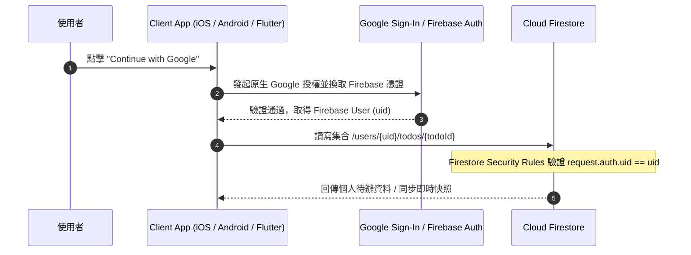

# 系統架構與技術設計書 (DESIGN.md)

> **文件狀態**：Accepted / 架構設計已定案（已完成 `/grill-me-doc` 深度訪談收斂，可作為三平台實作與測試依據）。

## 1. 技術選型總覽 (Tech Stack)

| 層次 | 技術選型 | 範圍 / 工具 | 決策重點說明 |
| :--- | :--- | :--- | :--- |
| **開發方法論** | **TDD（測試驅動開發）** | Red ➔ Green ➔ Refactor | 先依 `SPEC.md` 與 `DESIGN.md` 撰寫失敗測試，再撰寫最小可行程式碼並重構 |
| **規格與設計流程** | **Design-as-Code + `/grill-me-doc`** | `FigmaDesigner/` + Markdown Specs | Figma 管理視覺與 Design Tokens；Markdown 管理需求、狀態機、資料模型與 ADR |
| **資料與驗證後端** | **Firebase（Serverless 直連架構）** | Firebase Auth + Cloud Firestore | **不自建後端 API Server**，由 iOS / Android / Flutter 三平台直接串接 Firebase SDK |
| **REST API 管理層** | **依平台標準化選型** | **Android**：`Retrofit`<br/>**Flutter**：`Retrofit` (`dio` + `retrofit`)<br/>**iOS**：`Moya` | 當呼叫 RESTful HTTP API（或未來擴充外部服務）時統一採各自平台標準封裝，並自動注入 Firebase ID Token |
| **第三方認證** | **Google Sign-In + Firebase Auth** | 原生 Google SDK + Firebase Auth | 登入換取 Firebase Auth 使用者身分 (`uid`)，供 Cloud Firestore Rules 進行資料隔離 |
| **iOS 前端** | **Swift + SwiftUI** | `iOS/`（API 管理採 `Moya`） | 採 **MVVM + Routing + DTO + Entity + Repository/Service** 分層，1:1 映射 `README.md` iOS Code Syntax |
| **Android 前端** | **Kotlin + Jetpack Compose** | `Android/`（API 管理採 `Retrofit`） | 採 **MVVM + Routing + DTO + Entity + Repository/Service** 分層，1:1 映射 `README.md` Android Code Syntax |
| **Flutter 前端** | **Dart + Flutter (`GetX`)** | `Flutter/`（**僅限 Android 與 iOS**；API 管理採 `Retrofit`） | 採 **GetX 框架 + MVVM + Routing (`AppPages`) + DTO + Entity + Service/Repository** 分層（不支援 Web / Desktop） |
| **環境預檢機制** | **`toolchain.json` + `check_env`** | `check_env.sh` / `check_env.bat` / `tool/` | **強制前置關卡**：開始實作或建置前必須優先執行預檢，確保符合 `toolchain.json` 基準 |

---

## 2. 專案目錄架構 (Monorepo Layout)

```text
MCPTest/
├── AGENTS.md                        # 跨工具 AI 代理協作總規範
├── README.md                        # Figma Design System (Tokens / Styles / Pages / Components)
├── SPEC.md                          # 功能與需求規格書（含領域術語表與 BDD 驗收標準）
├── DESIGN.md                        # 系統架構與技術設計書（含 Firebase 設定、Schema 與 ADR）
├── toolchain.json                   # 三平台開發環境 Toolchain 版本唯一真理來源 (SSOT)
├── firestore.rules                  # Cloud Firestore 安全規則（/users/{uid}/todos/{todoId}）
├── check_env.sh                     # macOS / Linux / CI 預檢腳本入口
├── check_env.bat                    # Windows 預檢腳本入口
├── sync_shared.sh                   # Pre-Build 共用資源同步腳本入口
├── tool/
│   ├── check_env.dart               # 預檢 CLI 入口 (dart tool/check_env.dart)
│   ├── toolchain_checker.dart       # 預檢比對核心模組
│   └── sync_shared.dart             # shared/ 與 icons/*.svg 同步核心腳本
├── .agents/
│   └── skills/
│       └── grill-me-doc/            # 深度訪談與規格文檔化 Agent Skill
├── shared/
│   ├── animations/                  # 三平台共用 Lottie 動畫資產 SSOT
│   │   ├── circle-loader-light.json    # Light Mode 淺底按鈕用 (#111827 / #E5E7EB)
│   │   ├── circle-loader-dark.json     # Dark Mode 深底按鈕用 (#F9FAFB / #2E3A4E)
│   │   └── circle-loader-on-brand.json # 品牌主色藍底按鈕用 (#FFFFFF / 30% White)
│   └── firebase/                    # 三平台共用 Firebase 設定檔 SSOT
│       ├── google-services.json     # Android / Flutter(Android) Firebase 設定
│       └── GoogleService-Info.plist # iOS / Flutter(iOS) Firebase 設定
├── FigmaDesigner/                   # Figma Design-as-Code 腳本與本機開發外掛
├── iOS/                             # iOS (SwiftUI + Moya + Lottie) 原生專案
├── Android/                         # Android (Jetpack Compose + Retrofit + Lottie) 原生專案
└── Flutter/                         # Flutter (GetX + Retrofit + Lottie) 跨平台專案
```

---

## 3. 身分驗證與資料安全流程 (Auth & Security Flow)



### 3.1 共用 Firebase 專案與原生識別碼 SSOT
三平台共用設定檔統一集中於 **`shared/firebase/`**（建置前透過 `sync_shared.sh` 同步至各平台）：
- **Firebase Project ID**：`{firebaseProjectId}`（Project Number：`{firebaseProjectNumber}`）
- **Storage Bucket**：`{firebaseProjectId}.firebasestorage.app`
- **Android 唯一真理來源**（[shared/firebase/google-services.json](./shared/firebase/google-services.json)）：
  - `package_name`：**`{packageName}`**
  - Android OAuth Client (`client_type: 1`)：`{androidClientId}`（SHA-1：`{androidCertSha1}`）
  - Web OAuth Client (`client_type: 3`)：`{webClientId}`
- **iOS 唯一真理來源**（[shared/firebase/GoogleService-Info.plist](./shared/firebase/GoogleService-Info.plist)）：
  - `BUNDLE_ID`：**`{bundleId}`**
  - `CLIENT_ID`：`{iosClientId}`
  - `REVERSED_CLIENT_ID`：`{iosReversedClientId}`（已配置於 iOS / Flutter iOS `CFBundleURLTypes`）

---

## 4. Cloud Firestore 資料模型與安全規則規劃

- **Database Edition & ID**：**Standard edition**，採用預設 Database ID **`(default)`**（三平台官方 SDK 預設直連，不需自訂 `databaseId`；Firebase Console 建立時選 **`Start in production mode`** 並套用下方 Rules）。
- **集合路徑**：`/users/{uid}/todos/{todoId}`
- **文件欄位結構（對齊 `SPEC.md` 3 欄位）**：

```json
{
  "title": "Buy groceries",
  "dueDate": "2026-11-20",
  "status": "TODO",
  "createdAt": "<ServerTimestamp>",
  "updatedAt": "<ServerTimestamp>"
}
```

- **欄位值約束**：
  - `title`：非空字串（去空白後 1~100 字元）
  - `dueDate`：嚴格 ISO `yyyy-mm-dd` 格式字串（列表依 `dueDate` 升冪排序）
  - `status`：`"TODO"` | `"IN PROGRESS"` | `"DONE"`
- **Firestore 自動化前置設定與規則發佈流程（強制前置阻斷關卡：每次建立新分支或開始任一平台實作前，皆須重新執行 `./check_env.sh && ./setup_firebase.sh`，禁止沿用先前執行結果）**：
  1. 透過 `firebase.json`、`firestore.indexes.json` 與 `.firebaserc` 定義目標專案 `{firebaseProjectId}`、資料庫 `(default)` 與區域 `asia-east1`。
  2. `./setup_firebase.sh` 自動檢查 `(default)` Standard edition Cloud Firestore 資料庫是否存在；若無則自動透過 Firebase CLI 建立（`firebase firestore:databases:create "(default)" --edition=standard --location=asia-east1`）。
  3. 自動執行 `firebase deploy --only firestore` 發佈 `firestore.rules` 與 `firestore.indexes.json` 至雲端（確保即時生效，避免回傳 `permission-denied`），並同步 `shared/` 資源至三平台。
- **Firestore Security Rules 強制驗證規格**：
  - 僅允許已驗證使用者（`request.auth != null && request.auth.uid == uid`）讀寫 `/users/{uid}/todos/{todoId}`，禁止匿名存取與跨帳號讀寫。
  - Create / Update 強制校驗必填欄位：`title` 為非空字串（去空白後長度 `1..100`）、`dueDate` 符合 `^\d{4}-\d{2}-\d{2}$`、`status` 僅限 `['TODO', 'IN PROGRESS', 'DONE']`，並驗證 `createdAt` 於更新時不可變更、`updatedAt` 為有效 Timestamp。

---

## 5. 各平台架構規範摘要（統一採 `MVVM + Routing + DTO + Entity`）

三平台統一採 **MVVM + Routing + DTO + Entity (+ Repository / Service)** 乾淨分層，資料流為：`View` ➔ `ViewModel` ➔ `Repository / Service` ⇄ `DTO` ⇄ `Entity`，頁面導航集中於獨立的 `Routing` 層管理；所有平台 UI 實作前皆須先逐行核對 [`FigmaDesigner/components.js`](./FigmaDesigner/components.js) 與 [`FigmaDesigner/screens/*.js`](./FigmaDesigner/screens/main.js) 原碼數值，並遵守系統 Modal/Sheet 容器原生定位與圓角參數規範。

> **跨平台裝置與螢幕方向規範（Phone Only｜Portrait & Portrait Upside Down）**：
> - **支援裝置**：三平台皆為 **Phone Only（僅支援手機）**，不支援平板（iPad / Android Tablet）。
> - **螢幕方向**：僅支援 **Portrait（直向）** 與 **Portrait Upside Down（倒立直向）**，不支援橫向（Landscape）。
> - **各平台實作對齊**：
>   - **iOS (`iOS/`)**：`TARGETED_DEVICE_FAMILY` 必須設為 `"1"`（僅支援 iPhone，不納入 iPad `"2"`），且 `Info.plist` 之 `UISupportedInterfaceOrientations` 僅列 `UIInterfaceOrientationPortrait` 與 `UIInterfaceOrientationPortraitUpsideDown`（藉此避免同時啟用 iPad 家族卻未支援全 4 方向時，觸發 Xcode / App Store `All interface orientations must be supported unless the app requires full screen.` 警告）。
>   - **Android (`Android/`)**：維持手機目標裝置，Activity 方向鎖定為支援直向與反向直向（`sensorPortrait`）。
>   - **Flutter (`Flutter/`)**：於啟動時透過 `SystemChrome.setPreferredOrientations([DeviceOrientation.portraitUp, DeviceOrientation.portraitDown])` 鎖定直向與倒立直向，並同步將原生 iOS / Android 宿主專案設定為 Phone Only。

### 5.1 `Flutter/`（僅限 Android & iOS｜GetX 框架 + MVVM + Routing + DTO + Entity + Retrofit）
> **支援平台限制**：`Flutter/` 專案**僅支援 Android 與 iOS 行動平台**（僅保留 `android/` 與 `ios/`，嚴禁包含或建置 `web/`、`macos/`、`windows/`、`linux/`）。

1. **Routing (`lib/app/routes/`)**：以 GetX `AppRoutes` + `AppPages`（`GetPage` + `Bindings`）集中管理頁面跳轉、深層連結與依賴注入。
2. **Entity (`lib/app/data/entities/`)**：純領域模型（`TodoEntity`），不耦合 Firebase SDK、GetX 或 JSON 格式。
3. **DTO (`lib/app/data/dtos/`)**：負責 Firestore Document / JSON 序列化與反序列化，提供 `toEntity()` 與 `fromEntity()`。
4. **Service / Repository (`lib/app/data/services/`, `repositories/`)**：封裝 Firebase Auth 與 Cloud Firestore SDK 操作；RESTful HTTP API 統一採用 **`dio` + `retrofit` + `json_annotation`**，並透過 Dio Interceptor 自動注入 Firebase Bearer Token。
5. **ViewModel (`lib/app/modules/<module>/viewmodels/` 或 `controllers/`)**：使用 **`GetxController`** 作為 MVVM 的 ViewModel，管理響應式狀態（`Rx`）、協調 Repository 並透過 `Get.toNamed` / `Get.offAllNamed` 驅動 Routing。
6. **View / Widget (`lib/app/modules/<module>/views/` & `widgets/`)**：純 UI 視圖層，透過 `GetView<T>` 與 `Obx` 綁定 ViewModel，並 1:1 映射 `README.md` 的 Design Tokens。

### 5.2 `Android/`（Jetpack Compose + MVVM + Routing + DTO + Entity + Retrofit）
- **Routing (`ui/navigation/`)**：採用 Jetpack Compose Navigation（`NavHost` / Type-Safe Routes）集中管理頁面導覽與登入態導向。
- **Entity (`domain/model/`) & DTO (`data/dto/`)**：領域模型與網路 / Firestore 序列化模型分離，透過 Mapper (`toEntity()` / `fromEntity()`) 轉換。
- **Repository / Service (`data/repository/`, `data/remote/`)**：封裝 Firebase SDK 與 **`Retrofit`**（搭配 `OkHttp` + Auth Interceptor 注入 Firebase ID Token）。
- **ViewModel (`ui/.../*ViewModel.kt`) & View (Composable)**：UI Composable 僅觀察 `StateFlow` 並發送事件，不直接耦合資料層；UI 全面對齊 `README.md` Android Code Syntax。

### 5.3 `iOS/`（SwiftUI + MVVM + Routing + DTO + Entity + Moya）
- **Routing (`App/Routing/`)**：以獨立 `Router` / `NavigationStack` + Route Enum 集中管理畫面跳轉與登入根視圖切換。
- **Entity (`Domain/Entities/`) & DTO (`Data/DTOs/`)**：領域模型與網路 / Firestore `Codable` DTO 分離，提供明確映射轉換。
- **Repository / Service (`Data/Repositories/`, `Data/Network/`)**：封裝 Firebase SDK 與 **`Moya`**（以 `TargetType` 定義端點，搭配 `PluginType` 注入 Firebase ID Token 與日誌紀錄）。
- **ViewModel (`Presentation/.../*ViewModel.swift`) & View (SwiftUI)**：View 僅綁定 ViewModel 狀態，嚴格隔離資料層；UI 全面對齊 `README.md` iOS Code Syntax。

### 5.4 共用 Lottie Loading 動畫規範 (`shared/animations/`)
- Loading Indicator 不使用系統原生 Spinner 或靜態 SVG，三平台統一引入官方 **Lottie** 套件並循環播放 `shared/animations/` 內已預先對齊 Design Tokens 色碼的動畫檔（尺寸 `size/icon-md = 20px`）：
  - **iOS (`iOS/`)**：**`lottie-ios`**（SPM，`LottieView`）
  - **Android (`Android/`)**：**`lottie-compose`**（`com.airbnb.android:lottie-compose`，`LottieAnimation`）
  - **Flutter (`Flutter/`)**：**`lottie`**（pub.dev `lottie`，`Lottie.asset`）
- **三情境資產對照（免額外寫 Keypath 覆寫）**：
  - **`circle-loader-light.json`**：Light Mode 淺底按鈕（`Google Login Button`，前景色 `light/text/primary` `#111827` + 軌道 `light/border/default` `#E5E7EB`）
  - **`circle-loader-dark.json`**：Dark Mode 深底按鈕（`Google Login Button`，前景色 `dark/text/primary` `#F9FAFB` + 軌道 `dark/border/default` `#2E3A4E`）
  - **`circle-loader-on-brand.json`**：品牌藍底主按鈕（`AddTaskSheet` `"Add Task"` / `"Save"`，純白 `text/on-brand` `#FFFFFF` + 30% 透明白軌道）

---

## 6. 架構決策記錄 (Architecture Decision Records, ADRs)

### ADR-001: 三平台直接串接 Firebase Auth 與 Cloud Firestore（無自建後端）
- **狀態**：Accepted
- **背景**：本專案目前包含 `iOS/`、`Android/`、`Flutter/` 三個客戶端平台，核心功能為 Google 登入與個人待辦事項管理，並未規劃獨立後端伺服器。
- **決策**：三平台各自直接整合 Firebase Auth（Google Sign-In）與 Cloud Firestore SDK，透過 `/users/{uid}/todos/{todoId}` 子集合與 Firestore Security Rules 完成身分驗證與資料隔離。
- **優點**：免除自建與維運後端 API 伺服器的成本，三平台資料結構與安全邊界統一由 Firestore 與 Rules 控管。

### ADR-002: `shared/`（Firebase 設定與動畫資產）作為三平台唯一真理來源並於建置前同步
- **狀態**：Accepted
- **背景**：`shared/firebase/`（`google-services.json`、`GoogleService-Info.plist`）與 `shared/animations/`（`circle-loader-*.json`）需同時服務 `Android/`、`iOS/` 與 `Flutter/`。
- **決策**：統一集中存放於 `shared/` 作為唯一真理來源（SSOT）；各平台識別碼無條件對齊其中的 `package_name` / `BUNDLE_ID`（`{packageName}` / `{bundleId}`），且**每次平台建置與打包前必須先從 `shared/` 拷貝覆蓋最新檔案至各自平台目錄**（禁止單獨修改平台複本）。
- **優點**：確保三平台永遠拿到最新版本，避免更新 `shared/` 後漏同步導致 App ID 不一致或資源過期。

### ADR-003: Dual-Core Design-as-Code + Markdown Specs
- **狀態**：Accepted
- **背景**：跨平台開發需要兼顧視覺一致性（Figma）與行為邏輯可追溯性（Specs / ADRs）。
- **決策**：以 `FigmaDesigner/` + `README.md` 作為視覺與 Design Tokens 真理來源，以 `SPEC.md` + `DESIGN.md` + `.agents/skills/grill-me-doc/` 作為行為規格與架構決策真理來源。

### ADR-004: 嚴格實施 TDD 與業務程式碼零 Mock 原則
- **狀態**：Accepted
- **背景**：避免 AI 在跨平台實作中產生未經測試的邏輯或以假資料掩蓋憑證/連線問題。
- **決策**：所有業務邏輯與狀態控制層均採 Red ➔ Green ➔ Refactor 流程；正式程式碼目錄禁止出現假 Token 或 Mock 資料，若缺乏雲端憑證應立即回報阻斷。

### ADR-005: 建立 `toolchain.json` 唯一真理來源與跨平台 `check_env` 預檢機制
- **狀態**：Accepted
- **背景**：進入 iOS / Android / Flutter 實作後，各平台對 macOS、Xcode、Swift、CocoaPods、JDK、Gradle、AGP、Android SDK / NDK 與 Flutter / Dart SDK 版本高度敏感。
- **決策**：於專案根目錄建立 [`toolchain.json`](./toolchain.json) 鎖定目前基準版本，並以純 Dart 實作 [`tool/check_env.dart`](./tool/check_env.dart)、[`tool/toolchain_checker.dart`](./tool/toolchain_checker.dart) 搭配 [`check_env.sh`](./check_env.sh) / [`check_env.bat`](./check_env.bat)；所有三平台開發、建置與測試前皆必須先通過預檢（Exit Code 0）。

### ADR-006: 三平台 RESTful API 管理層選型（Android & Flutter 採用 Retrofit，iOS 採用 Moya）
- **狀態**：Accepted
- **背景**：除了 Firebase Auth / Cloud Firestore SDK 直連操作外，三平台須明確定義統一規格的 HTTP REST API 管理框架，以應對未來擴充外部 RESTful 服務、Cloud Functions 或統一網路攔截與測試替身設計。
- **決策**：
  1. **Android (`Android/`)**：統一採用 **Retrofit**（搭配 `OkHttp` Auth Interceptor）。
  2. **Flutter (`Flutter/`)**：統一採用 **Retrofit**（`dio` + `retrofit` + `json_annotation`）。
  3. **iOS (`iOS/`)**：統一採用 **Moya**（透過 `TargetType` enum 集中管理端點與 `PluginType` 注入驗證標頭）。
- **優點**：三平台皆採宣告式（Declarative）端點定義，介面清楚且極易於在 TDD 中替換為測試替身或 Stub Provider。

### ADR-007: 待辦事項刪除機制採用硬刪除（Hard Delete）
- **狀態**：Accepted
- **背景**：需決定待辦事項向左滑動刪除時，於 Cloud Firestore 層採用 `isDeleted` 軟刪除標記或直接實體刪除。
- **決策**：直接呼叫 Firestore `.delete()` 從 `/users/{uid}/todos/{todoId}` 實體移除該文件，不保留軟刪除欄位。
- **優點**：集合結構乾淨、無須過濾軟刪除文件與額外索引，且符合現行 3 欄位 MVP 設計。

### ADR-008: 採用 Cloud Firestore 即時監聽 (`snapshots`) 與預設離線快取
- **狀態**：Accepted
- **背景**：行動端 App 常有短暫斷線或跨裝置同步需求，且個人待辦資料量較小。
- **決策**：三平台統一使用 Cloud Firestore `snapshots()` 即時監聽 `/users/{uid}/todos`（依 `dueDate` 升冪查詢），並開啟 SDK 預設本地離線快取（Offline Persistence）。
- **優點**：狀態推進、編輯與刪除可零延遲更新 UI，且離線時仍可瀏覽與排隊同步，連網後自動寫回雲端。

### ADR-009: Loading 動畫採用預着色多版本 Lottie JSON（`shared/animations/`）
- **狀態**：Accepted
- **背景**：按鈕內的 Loading 需同時支援 Light Mode 淺底、Dark Mode 深底與品牌藍底反白三種背景，且 `iOS` / `Android` / `Flutter` 若各自寫 Keypath 覆寫程式容易出現平台差異。
- **決策**：將來源 `circle-loader.json` 依 Design Tokens 預先產生 `circle-loader-light.json`、`circle-loader-dark.json` 與 `circle-loader-on-brand.json` 存放於 `shared/animations/`，三平台各自引入 `lottie-ios`、`lottie-compose`、`lottie` 直接依背景／深淺色選檔播放。
- **優點**：三平台動畫曲線與配色 100% 一致，免去各平台額外維護 Lottie Keypath `ColorValueProvider` / `ValueDelegate` 程式碼，同時不污染 Figma 靜態圖示庫。

### ADR-010: 支援裝置與螢幕方向鎖定為 Phone Only（Portrait & Portrait Upside Down）
- **狀態**：Accepted
- **背景**：本專案 UI 設計系統以單欄手機介面（Figma 參考畫布 `393 × 852`，採 Auto Layout 自適應所有直向手機螢幕，不鎖死視窗大小）為基準；若未限制裝置家族，iOS 預設 `TARGETED_DEVICE_FAMILY = "1,2"`（含 iPad）在僅支援直向時會因 iPad 多工機制觸發 `All interface orientations must be supported unless the app requires full screen.` 警告。
- **決策**：三平台明確定義為 **Phone Only**，螢幕方向僅支援 **Portrait（直向）** 與 **Portrait Upside Down（倒立直向）**；iOS 專案將 `TARGETED_DEVICE_FAMILY` 設為 `"1"` 並於 `Info.plist` 設定 `UIInterfaceOrientationPortrait` 與 `UIInterfaceOrientationPortraitUpsideDown`（Android 採 `sensorPortrait`、Flutter 採 `portraitUp` / `portraitDown`）。
- **優點**：聚焦手機單欄最佳體驗、消除 iPad 多工方向限制警告，並確保三平台裝置與方向行為一致。

---

## 7. 三平台 Toolchain 版本基準矩陣（對齊 `toolchain.json`）

以下版本基準依目前本機實測環境建立於 [`toolchain.json`](./toolchain.json)：

| 工具 / 組件 | 適用平台 | 最低版本要求 | 推薦 / 本機基準版本 | 備註 |
| :--- | :--- | :---: | :---: | :--- |
| **macOS** | iOS / Flutter(iOS) | `>= 26.0` | `26.6.2` (`25G83`, `arm64`) | 本機建置主機 |
| **Xcode** | iOS / Flutter(iOS) | `>= 26.0` | `26.6` (`17F113`) | 需配合 iOS SDK |
| **Swift** | iOS | `>= 6.0` | `6.3.3` | Apple Swift 編譯器 |
| **CocoaPods** | iOS / Flutter(iOS) | `>= 1.16.0` | `1.16.2` | 相依管理（可與 SPM 搭配） |
| **Flutter SDK** | Flutter | `>= 3.41.0` | `3.41.9` (`stable`) | 跨平台 UI 框架 |
| **Dart SDK** | Flutter | `>= 3.11.0` | `3.11.5` | 隨 Flutter SDK 發行 |
| **Java JDK** | Android / Flutter(Android) | `>= 17` | `17.0.19`（JBR `21.0.10`） | 本機 Homebrew OpenJDK 17 / Android Studio JBR 21 |
| **Gradle** | Android / Flutter(Android) | `>= 9.0.0` | `9.8.2` | 參考本機既有 Android 專案 Wrapper 基準 |
| **Android Gradle Plugin** | Android / Flutter(Android) | `>= 9.0.0` | `9.4.1` | 參考本機既有 AGP 基準 |
| **Kotlin** | Android | `>= 2.0.0` | `2.4.21` | Jetpack Compose 專案語言 |
| **Android Compile SDK** | Android / Flutter(Android) | `>= 34` | `37` (`android-37.0`) | 本機已安裝 `android-34` ~ `android-37.0`、Build-Tools `37.0.0` |
| **Android NDK** | Android / Flutter(Android) | `28.2.13676358` | `28.2.13676358` | 本機已安裝版本 |

---

## 8. `/grill-me-doc` 深度訪談決議清單（全數定案）
- [x] 待辦事項維持 3 欄位（`title`、`dueDate`、`status`），對齊現行 Figma 設計
- [x] `dueDate` 採 ISO `yyyy-mm-dd` 儲存 + 系統 DatePicker 輸入，列表依 `dueDate` 升冪排序
- [x] 支援點擊卡片編輯（重用 `AddTaskSheet`）與左滑硬刪除（Hard Delete，ADR-007）
- [x] `Main Screen` 底部配置 `"LogOut"` 按鈕（bottom margin `3xl` = `32px`），點擊立即登出導回 `Login`
- [x] 啟用 Cloud Firestore 即時監聽 (`snapshots`) + 預設離線快取（ADR-008）、Empty State 引導文案與 Security Rules 欄位嚴格校驗
