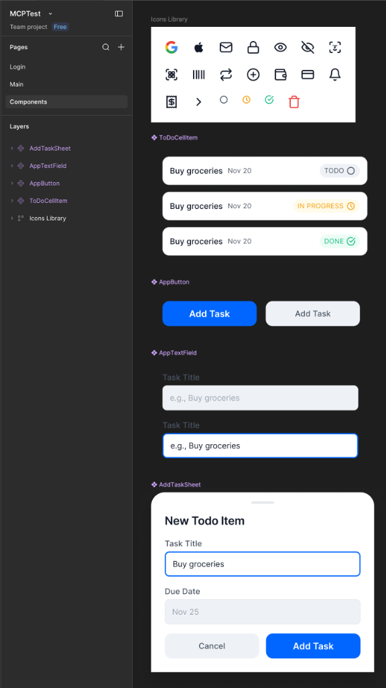
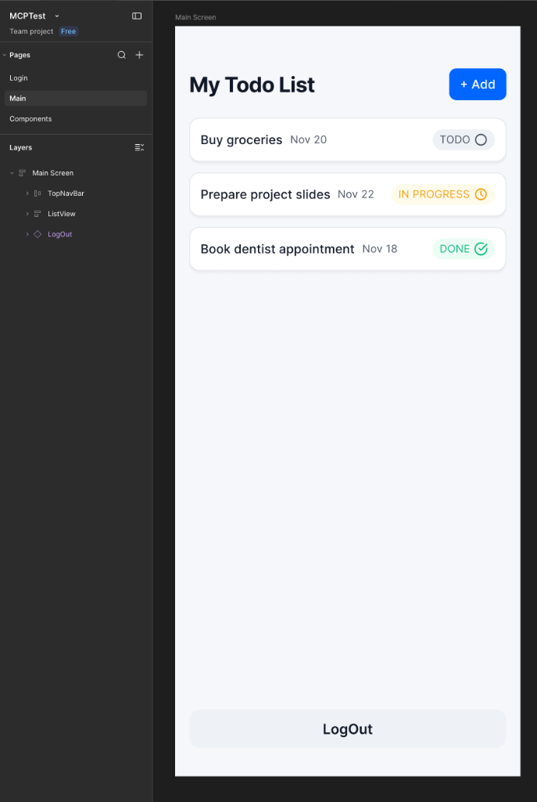
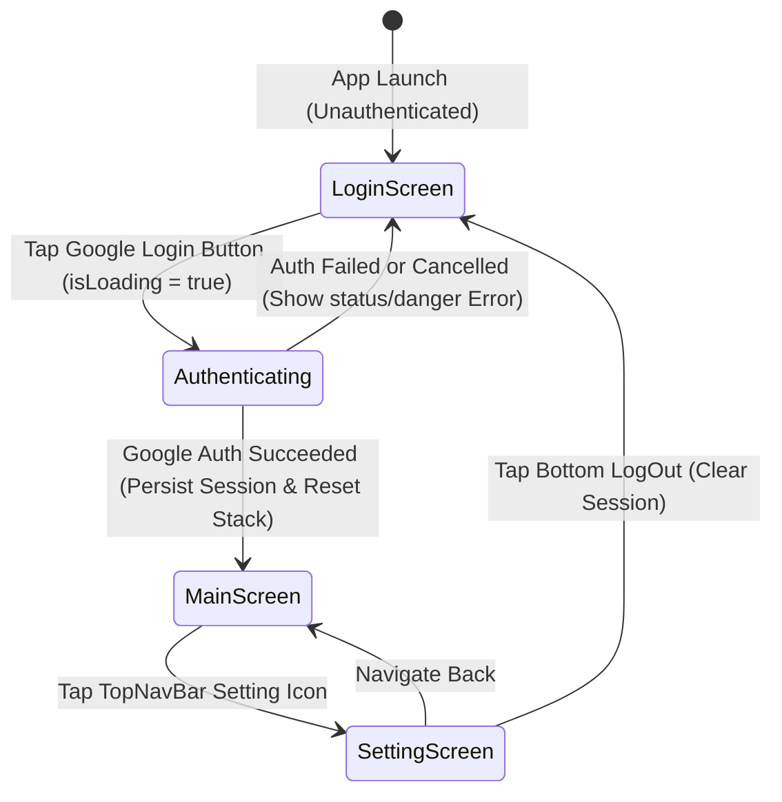

# TodoList — Figma Design-as-Code & AI-Ready Design System

[](./LICENSE)

> **Documentation**: Product Specs [`SPEC.md`](./SPEC.md) | Architecture & Toolchain [`DESIGN.md`](./DESIGN.md) | AI Agent Guidelines [`AGENTS.md`](./AGENTS.md)

This repository demonstrates how to combine **Figma Design-as-Code (via a local Figma Plugin)** with **Dual-Core Specifications (Figma for Visuals + Markdown for Behavior)** so that your entire design system lives in Git and enables AI Agents (with Figma MCP) to generate 1:1 cross-platform UI (iOS SwiftUI, Android Jetpack Compose, Flutter) with zero hardcoded values.

- **Figma File Link**: [TodoList Figma Design](https://www.figma.com/design/{figmaFileKey}/MCPTest)
- **File Key**: `{figmaFileKey}`
- **Full Tutorial (English / Medium-Ready)**: Jump to [Section 8: Hands-On Tutorial](#8-hands-on-tutorial-building-an-ai-ready-figma-design-system-with-design-as-code) for a step-by-step walkthrough.

### 📸 Preview (Generated by `TodoList FigmaDesigner` Plugin)

| `Components` Page (Icons & Reusable Variants) | `Main` Page (Auto-Layout Screen) |
| :---: | :---: |
|  |  |

### 🚀 Quick Start

1. **Build the local Figma Plugin**:
   ```bash
   sh FigmaDesigner/build_plugin.sh && node --check FigmaDesigner/plugin/code.js
   ```
   *(Optional: Run `sh FigmaDesigner/build_plugin.sh --watch` for automatic rebuilds while editing scripts.)*
2. **Import into Figma Desktop**:
   - Open an empty Figma Design file and go to `Plugins` ➔ `Development` ➔ `Import plugin from manifest...`, then select [`FigmaDesigner/manifest.json`](./FigmaDesigner/manifest.json).
   - Run **TodoList FigmaDesigner** and click **`🚀 Rebuild All`** (`Foundations ➔ Components ➔ Screens`) to generate the entire design system and screens in seconds.
3. **Configure `{option}` Placeholders (Optional for App Implementation)**:
   - All project-specific identifiers and credentials in this template are replaced with `{option}` placeholders (e.g., `{firebaseProjectId}`, `{packageName}`, `{bundleId}`, `{figmaFileKey}`). Replace them with your own values, then run `./check_env.sh && ./setup_firebase.sh` before starting native/Flutter development.

---

## 1. Figma Design System Architecture & Responsibilities

Following Figma's modern conventions (such as Simple Design System), design foundations are divided into **`Variables` (scalar primitive values)** and **`Styles` (composite `struct` definitions)**:

| Category | Data Structure Concept | Managed Properties | Figma Collection / Panel |
| :--- | :--- | :--- | :--- |
| **`Variables`** | Primitive (`Key -> Single Value`) | 1. **Solid Colors**<br/>2. **Spacing / Gap / Padding**<br/>3. **Corner Radius**<br/>4. **Stroke Weight & Component Size** | • `ColorCollection` (42 variables)<br/>• `SpacingCollection` (26 variables) |
| **`Styles`** | Composite (`Key -> Multi-Property Bundle`) | 1. **Typography (`Text Styles`)**: Font family + weight + size + line height + letter spacing<br/>2. **Visual Effects (`Effect Styles`)**: Shadows (`Drop/Inner Shadow`) + Blur<br/>3. **Composite Fills (`Color Styles`)**: Gradients and multi-layer image/texture fills | • `Text styles` (12 scales)<br/>• `Effect styles` (3 `Elevation` tiers)<br/>• `Color styles` (gradients only) |

> [!IMPORTANT]
> **Why not store solid colors in `Color Styles`?**
> Solid colors always use `Color Variables` so they support **Scopes** (property-picker filtering) and **Code Syntax** (`Color.bgSurface` / `colorBgSurface`). Only gradients or multi-layer fills belong in `Color Styles`.

---

## 2. `ColorCollection` — Semantic Color Variables (Light / Dark Mode)

- **Collection ID**: `VariableCollectionId:71:22`
- **Group Structure**: Due to Figma Starter plan's single-mode limit, `ColorCollection` organizes colors into two semantic groups—`light/...` (21 variables) and `dark/...` (21 variables)—with both mapping their **Code Syntax** to the exact same semantic token name.

### 2.1 Color Variable Reference (42 Variables)

| Category | Light Variable | Light Hex | Dark Variable | Dark Hex | Scopes | Usage | Web / iOS / Android Code Syntax |
| :--- | :--- | :---: | :--- | :---: | :--- | :--- | :--- |
| **Background & Surface** | `light/bg/canvas` | `#F5F7FA` | `dark/bg/canvas` | `#0B0F17` | `FRAME_FILL`, `SHAPE_FILL` | Main app screen background | `var(--color-bg-canvas)`<br/>`Color.bgCanvas`<br/>`colorBgCanvas` |
| | `light/bg/surface` | `#FFFFFF` | `dark/bg/surface` | `#151C28` | `FRAME_FILL`, `SHAPE_FILL` | Cards, todo rows, button containers | `var(--color-bg-surface)`<br/>`Color.bgSurface`<br/>`colorBgSurface` |
| | `light/bg/elevated` | `#FFFFFF` | `dark/bg/elevated` | `#1E2736` | `FRAME_FILL`, `SHAPE_FILL` | Modals, bottom sheets, floating overlays | `var(--color-bg-elevated)`<br/>`Color.bgElevated`<br/>`colorBgElevated` |
| | `light/bg/subtle` | `#EEF2F6` | `dark/bg/subtle` | `#253042` | `FRAME_FILL`, `SHAPE_FILL` | Secondary blocks, input fields, status pill backgrounds | `var(--color-bg-subtle)`<br/>`Color.bgSubtle`<br/>`colorBgSubtle` |
| **Brand & Action** | `light/brand/primary` | `#0066FF` | `dark/brand/primary` | `#3385FF` | `FRAME_FILL`, `SHAPE_FILL`, `TEXT_FILL`, `STROKE_COLOR` | Primary brand color (Primary CTA, main action buttons) | `var(--color-brand-primary)`<br/>`Color.brandPrimary`<br/>`colorBrandPrimary` |
| | `light/brand/primary-pressed` | `#0052CC` | `dark/brand/primary-pressed` | `#66A3FF` | `FRAME_FILL`, `SHAPE_FILL` | Primary button pressed / active state | `var(--color-brand-primary-pressed)`<br/>`Color.brandPrimaryPressed`<br/>`colorBrandPrimaryPressed` |
| | `light/brand/secondary` | `#E6F0FF` | `dark/brand/secondary` | `#122B54` | `FRAME_FILL`, `SHAPE_FILL` | Secondary brand tint (tags, badges) | `var(--color-brand-secondary)`<br/>`Color.brandSecondary`<br/>`colorBrandSecondary` |
| | `light/brand/accent` | `#F59E0B` | `dark/brand/accent` | `#FBBF24` | `FRAME_FILL`, `SHAPE_FILL`, `TEXT_FILL` | Accent highlights and emphasis markers | `var(--color-brand-accent)`<br/>`Color.brandAccent`<br/>`colorBrandAccent` |
| **Text & Icon** | `light/text/primary` | `#111827` | `dark/text/primary` | `#F9FAFB` | `TEXT_FILL`, `SHAPE_FILL` | Primary text, task titles, page headings | `var(--color-text-primary)`<br/>`Color.textPrimary`<br/>`colorTextPrimary` |
| | `light/text/secondary` | `#4B5563` | `dark/text/secondary` | `#9CA3AF` | `TEXT_FILL`, `SHAPE_FILL` | Secondary descriptions, due dates, helper info | `var(--color-text-secondary)`<br/>`Color.textSecondary`<br/>`colorTextSecondary` |
| | `light/text/muted` | `#9CA3AF` | `dark/text/muted` | `#6B7280` | `TEXT_FILL`, `SHAPE_FILL` | Placeholders, disabled text | `var(--color-text-muted)`<br/>`Color.textMuted`<br/>`colorTextMuted` |
| | `light/text/on-brand` | `#FFFFFF` | `dark/text/on-brand` | `#FFFFFF` | `TEXT_FILL`, `SHAPE_FILL` | Text and icons on primary brand buttons | `var(--color-text-on-brand)`<br/>`Color.textOnBrand`<br/>`colorTextOnBrand` |
| **Border & Divider** | `light/border/default` | `#E5E7EB` | `dark/border/default` | `#2E3A4E` | `STROKE_COLOR` | Default border for cards and input fields | `var(--color-border-default)`<br/>`Color.borderDefault`<br/>`colorBorderDefault` |
| | `light/border/focus` | `#0066FF` | `dark/border/focus` | `#3385FF` | `STROKE_COLOR` | Focused input border | `var(--color-border-focus)`<br/>`Color.borderFocus`<br/>`colorBorderFocus` |
| | `light/border/divider` | `#F3F4F6` | `dark/border/divider` | `#1F2937` | `STROKE_COLOR`, `FRAME_FILL`, `SHAPE_FILL` | List and section dividers | `var(--color-border-divider)`<br/>`Color.borderDivider`<br/>`colorBorderDivider` |
| **Semantic Status** | `light/status/success` | `#10B981` | `dark/status/success` | `#34D399` | `TEXT_FILL`, `SHAPE_FILL`, `FRAME_FILL`, `STROKE_COLOR` | Completed status (`DONE`), success indicators | `var(--color-status-success)`<br/>`Color.statusSuccess`<br/>`colorStatusSuccess` |
| | `light/status/success-bg` | `#ECFDF5` | `dark/status/success-bg` | `#064E3B` | `FRAME_FILL`, `SHAPE_FILL` | `DONE` pill / success banner background | `var(--color-status-success-bg)`<br/>`Color.statusSuccessBg`<br/>`colorStatusSuccessBg` |
| | `light/status/warning` | `#F59E0B` | `dark/status/warning` | `#FBBF24` | `TEXT_FILL`, `SHAPE_FILL`, `FRAME_FILL`, `STROKE_COLOR` | In-progress status (`IN PROGRESS`), reminders | `var(--color-status-warning)`<br/>`Color.statusWarning`<br/>`colorStatusWarning` |
| | `light/status/warning-bg` | `#FFFBEB` | `dark/status/warning-bg` | `#78350F` | `FRAME_FILL`, `SHAPE_FILL` | `IN PROGRESS` pill / warning banner background | `var(--color-status-warning-bg)`<br/>`Color.statusWarningBg`<br/>`colorStatusWarningBg` |
| | `light/status/danger` | `#EF4444` | `dark/status/danger` | `#F87171` | `TEXT_FILL`, `SHAPE_FILL`, `FRAME_FILL`, `STROKE_COLOR` | Error alerts, validation failures, destructive actions | `var(--color-status-danger)`<br/>`Color.statusDanger`<br/>`colorStatusDanger` |
| | `light/status/danger-bg` | `#FEF2F2` | `dark/status/danger-bg` | `#7F1D1D` | `FRAME_FILL`, `SHAPE_FILL` | Error / alert banner background | `var(--color-status-danger-bg)`<br/>`Color.statusDangerBg`<br/>`colorStatusDangerBg` |

### 2.2 Automatic Light / Dark Switching Across Mobile Platforms (iOS / Android / Flutter)

In mobile UI code, Views always reference a **single semantic token name** (such as `Color.bgCanvas` on iOS or `colorBgCanvas` on Android) without writing `if (isDark)` branches:

```text
Figma Design (Starter Plan Dual Groups)     Code Syntax Bridge        Mobile Code (Auto-switches with OS theme)
┌─────────────────────────────┐
│ light/bg/canvas (#F5F7FA)   │ ───┐
└─────────────────────────────┘    ├──>  iOS: Color.bgCanvas      ──> Light: #F5F7FA / Dark: #0B0F17
┌─────────────────────────────┐    │     Android: colorBgCanvas
│ dark/bg/canvas  (#0B0F17)   │ ───┘
└─────────────────────────────┘
```

---

## 3. `SpacingCollection` — Spacing, Radius, Stroke & Size Variables

- **Collection ID**: `VariableCollectionId:78:15`
- **Total Variables**: **26** `FLOAT` variables grouped into `spacing`, `radius`, `stroke`, and `size`

| Group | Variable Name | Value (px) | Scope | Usage | Web / iOS / Android Code Syntax |
| :--- | :--- | :---: | :--- | :--- | :--- |
| **`spacing`** | `spacing/none` | `0` | `GAP` | No spacing | `var(--spacing-none)` / `Spacing.none` / `spacingNone` |
| | `spacing/2xs` | `2` | `GAP` | Micro text gap | `var(--spacing-2xs)` / `Spacing.xxs` / `spacing2xs` |
| | `spacing/xs` | `4` | `GAP` | Label padding, title-to-subtitle gap | `var(--spacing-xs)` / `Spacing.xs` / `spacingXs` |
| | `spacing/sm` | `8` | `GAP` | Icon-to-text gap, compact padding | `var(--spacing-sm)` / `Spacing.sm` / `spacingSm` |
| | `spacing/md` | `12` | `GAP` | Standard inner component spacing, medium button vertical padding | `var(--spacing-md)` / `Spacing.md` / `spacingMd` |
| | `spacing/lg` | `16` | `GAP` | Standard card padding, screen horizontal margin, list row padding | `var(--spacing-lg)` / `Spacing.lg` / `spacingLg` |
| | `spacing/xl` | `20` | `GAP` | Spacious card padding, section gap | `var(--spacing-xl)` / `Spacing.xl` / `spacingXl` |
| | `spacing/2xl` | `24` | `GAP` | Bottom sheet padding, large section gap | `var(--spacing-2xl)` / `Spacing.xxl` / `spacing2xl` |
| | `spacing/3xl` | `32` | `GAP` | Major cross-section spacing | `var(--spacing-3xl)` / `Spacing.xxxl` / `spacing3xl` |
| | `spacing/4xl` | `48` | `GAP` | Large top/bottom screen inset | `var(--spacing-4xl)` / `Spacing.xxxxl` / `spacing4xl` |
| **`radius`** | `radius/none` | `0` | `CORNER_RADIUS` | Sharp corners | `var(--radius-none)` / `Radius.none` / `radiusNone` |
| | `radius/xs` | `4` | `CORNER_RADIUS` | Small badge / tag radius | `var(--radius-xs)` / `Radius.xs` / `radiusXs` |
| | `radius/sm` | `8` | `CORNER_RADIUS` | Small buttons, input fields, chips | `var(--radius-sm)` / `Radius.sm` / `radiusSm` |
| | `radius/md` | `12` | `CORNER_RADIUS` | Primary buttons, list cards | `var(--radius-md)` / `Radius.md` / `radiusMd` |
| | `radius/lg` | `16` | `CORNER_RADIUS` | Large info cards and containers | `var(--radius-lg)` / `Radius.lg` / `radiusLg` |
| | `radius/xl` | `24` | `CORNER_RADIUS` | Bottom sheets and modal dialogs | `var(--radius-xl)` / `Radius.xl` / `radiusXl` |
| | `radius/full` | `9999` | `CORNER_RADIUS` | Pill buttons, circular avatars, icon frames | `var(--radius-full)` / `Radius.full` / `radiusFull` |
| **`stroke`** | `stroke/thin` | `1` | `STROKE_FLOAT` | Standard card border and divider thickness | `var(--stroke-thin)` / `Stroke.thin` / `strokeThin` |
| | `stroke/medium` | `1.5` | `STROKE_FLOAT` | Emphasized borders | `var(--stroke-medium)` / `Stroke.medium` / `strokeMedium` |
| | `stroke/thick` | `2` | `STROKE_FLOAT` | Focused input border weight | `var(--stroke-thick)` / `Stroke.thick` / `strokeThick` |
| **`size`** | `size/icon-sm` | `16` | `WIDTH_HEIGHT` | Small status or chevron icon size | `var(--size-icon-sm)` / `Size.iconSm` / `sizeIconSm` |
| | `size/icon-md` | `20` | `WIDTH_HEIGHT` | Button and input inline icon size | `var(--size-icon-md)` / `Size.iconMd` / `sizeIconMd` |
| | `size/icon-lg` | `24` | `WIDTH_HEIGHT` | Navigation bar and shortcut icon size | `var(--size-icon-lg)` / `Size.iconLg` / `sizeIconLg` |
| | `size/control-sm` | `36` | `WIDTH_HEIGHT` | Compact button / tag height | `var(--size-control-sm)` / `Size.controlSm` / `sizeControlSm` |
| | `size/control-md` | `44` | `WIDTH_HEIGHT` | Standard touch button / input field height | `var(--size-control-md)` / `Size.controlMd` / `sizeControlMd` |
| | `size/control-lg` | `52` | `WIDTH_HEIGHT` | Primary CTA button height | `var(--size-control-lg)` / `Size.controlLg` / `sizeControlLg` |

---

## 4. `Text Styles` — Typography Scales (`struct`)

Each `Text Style` bundles **Font Family + Font Style (Weight) + Font Size + Line Height + Letter Spacing**, allowing designers and engineers to apply consistent typography in one step (`Amount/*` is also reserved for future summary/analytics metrics):

| Category | Text Style Name | Font (`fontName`) | Size | Line Height | Letter Spacing | Usage |
| :--- | :--- | :--- | :---: | :---: | :---: | :--- |
| **`Amount`**<br/>*(Reserved for analytics)* | `Amount/Hero` | `Inter Bold` | `36px` | `44px` | `-1.0px` | Hero metrics / large summary figures |
| | `Amount/Large` | `Inter Bold` | `28px` | `36px` | `-0.5px` | Summary card large numbers |
| | `Amount/Medium` | `Inter Semi Bold` | `20px` | `28px` | `-0.2px` | Subtotals and compact summary metrics |
| | `Amount/Inline` | `Inter Semi Bold` | `16px` | `24px` | `0px` | Inline right-aligned row figures |
| **`Heading`** | `Heading/H1` | `Inter Bold` | `24px` | `32px` | `-0.5px` | Main page titles |
| | `Heading/H2` | `Inter Semi Bold` | `20px` | `28px` | `-0.3px` | Section headings, bottom sheet titles |
| | `Heading/H3` | `Inter Semi Bold` | `17px` | `24px` | `-0.2px` | Card headers, navigation bar titles |
| **`Body`** | `Body/Large` | `Inter Regular` | `16px` | `24px` | `0px` | Primary body copy, task titles |
| | `Body/Medium` | `Inter Regular` | `14px` | `20px` | `0px` | Secondary descriptions, dialog copy, notes |
| **`Label`** | `Label/Large` | `Inter Semi Bold` | `16px` | `24px` | `0px` | Primary CTA button labels |
| | `Label/Medium` | `Inter Medium` | `14px` | `20px` | `0.1px` | Secondary buttons, tabs, input field labels |
| **`Caption`** | `Caption/Small` | `Inter Regular` | `12px` | `16px` | `0.2px` | Due dates, timestamps, status pill labels |

---

## 5. `Effect Styles` — Z-Axis Elevation & Visual Effects (`struct`)

While `SpacingCollection` governs planar **`X / Y` spacing**, **`Effect Styles` control Z-axis elevation and blur effects**.

### 5.1 The 4 Supported Figma Effect Types

Figma groups these under **`Effect styles`** rather than `Shadow styles` because an `Effect` supports four distinct visual treatments:

| Effect Type | Visual Behavior | Common App Usage | SwiftUI Equivalent |
| :--- | :--- | :--- | :--- |
| **1. `Drop shadow`**<br/>(~80% of use cases) | Projects a shadow outward to create a **floating** elevation | List cards (`Card`), floating action buttons (`Floating`), dialogs (`Modal`) | `.shadow(...)` |
| **2. `Inner shadow`** | Projects a shadow inward to create a **recessed** feel | Recessed input wells, tactile pressed-button states | Custom inner shadow overlay |
| **3. `Background blur`** | Blurs content behind a translucent layer (frosted glass) | Sticky top nav bars, floating tab bars, glassmorphic overlays | `.background(.ultraThinMaterial)` |
| **4. `Layer blur`** | Applies Gaussian blur directly to the layer itself | Privacy mode masking for sensitive text or figures | `.blur(radius: 8)` |

### 5.2 Defined `Elevation` Tiers (All Using `Drop shadow`)

| Effect Style | Effect Type | Elevation | Applied Scenarios | iOS / Android Implementation |
| :--- | :---: | :---: | :--- | :--- |
| **`Elevation/Card`** | `Drop shadow` | Low (subtle lift) | **Login button, todo list cards, general containers** | iOS: `.shadow(color: .black.opacity(0.06), radius: 4, x: 0, y: 2)`<br/>Android: `Modifier.shadow(2.dp)` |
| **`Elevation/Floating`** | `Drop shadow` | Medium | **Floating Action Buttons (FAB), top toast banners** | iOS: `.shadow(color: .black.opacity(0.12), radius: 12, x: 0, y: 6)`<br/>Android: `Modifier.shadow(6.dp)` |
| **`Elevation/Modal`** | `Drop shadow` | High (topmost) | **`AddTaskSheet` bottom sheet, modal dialogs** | iOS: `.shadow(color: .black.opacity(0.20), radius: 24, x: 0, y: 12)`<br/>Android: `Modifier.shadow(16.dp)` |

---

## 6. AI-Agent-Driven Workflow: Static Figma Screens + Markdown Specs

Instead of wiring complex click-through prototypes in Figma's `Prototype` tab, this workflow pairs **Figma MCP with Agent Skills and Markdown Specs** under a **Dual Source of Truth**:

### 6.1 Dual Source of Truth Responsibilities

| Dimension | Source of Truth | What It Defines | How AI Agents Consume It |
| :--- | :--- | :--- | :--- |
| **1. What it looks like** | 🎨 **Figma Design**<br/>(`TodoList`) | • **Tokens**: `ColorCollection`, `SpacingCollection`, `Text/Effect Styles`<br/>• **Components**: Dedicated `Components` page (`Icons Library` & shared components)<br/>• **Key Screens**: Clean static keyframes (`Login Screen`, `Main Screen`, `Setting Screen`) consolidated on a single `Screens` page built strictly with `Frame` + `Auto Layout` | Queries the node tree, Auto Layout rules (`Vertical`/`Horizontal`, `Fixed`/`Hug`/`Fill`), and Code Syntax via **Figma MCP** to generate 1:1 SwiftUI / Jetpack Compose / Flutter UI |
| **2. How it works** | 📄 **Codebase Markdown**<br/>(`SPEC.md` / `DESIGN.md` + `SKILL.md`) | • **User Flow & Navigation**: Transition triggers and navigation stack rules<br/>• **State & Logic**: State machines (`idle`/`loading`/`error`/`authenticated`) and Firestore / Auth integration<br/>• **Architecture**: Platform layering, TDD, and ADRs | Reads local Markdown specs and Agent Skills to generate business logic, state management, and unit tests |

### 6.2 Three-Step Closed-Loop Workflow

1. **Step 1 — Figma (Minimal Visual Definitions)**:
   - Maintain clean keyframe frames (`Login Screen`, `Main Screen`, `Setting Screen`) on a shared **`Screens`** page, and store reusable parts in a dedicated **`Components`** page (including `Icons Library`, synced from `FigmaDesigner/assets/icons/*.svg`).
   - Every container uses **`Frame` + `Auto Layout` (`Shift + A`)** bound to `ColorCollection`, `SpacingCollection`, `Text Styles`, and `Effect Styles`—no `Prototype` noodles needed.
   - All Figma assets (Collections, Styles, Components, Screens) are version-controlled in Git via `FigmaDesigner/*.js`.
2. **Step 2 — Repository Markdown (States & Flows)**:
   - Define navigation, error handling, and state transitions explicitly using Mermaid state diagrams in Markdown:



3. **Step 3 — AI Agent Cross-Platform Generation**:
   - AI agents combine the token mappings in this `README.md`, behavioral specs in [SPEC.md](./SPEC.md) / [DESIGN.md](./DESIGN.md), `FigmaDesigner/screens/*.js` sources, and live Figma `Screens` page structure (`Login Screen`, `Main Screen`, `Setting Screen`) to build iOS (SwiftUI), Android (Jetpack Compose), and Flutter UI, logic, and tests with **zero hardcoded values** and **automatic Light / Dark Mode support**.

---

## 7. Figma Pages & Reusable Components (`Pages & Components`)

> **Device & Orientation Baseline**: This design system targets **Phone Only** in **Portrait / Portrait Upside Down**. `393 × 852` is only a reference frame size for the static Figma canvas—all three mobile apps must adapt fluidly to any portrait phone screen via Auto Layout without locking fixed screen dimensions.

### 7.1 `Components` Page

1. **`Icons Library`**: Houses 21 standard vector icon components mapped 1:1 to `FigmaDesigner/assets/icons/*.svg`:
   - Auth & general: `Icon/google` (`ic_google.svg`), `Icon/apple` (`ic_apple.svg`), `Icon/mail`, `Icon/lock`, `Icon/eye`, `Icon/eye-off`, `Icon/face-id`, `Icon/setting` (`ic_setting.svg` — top-right settings navigation icon), `Icon/trash` (`ic_trash.svg` — swipe-to-delete action icon)
   *(Note: Button loading spinners do not use static SVGs; all three platforms load Lottie animations from `shared/animations/circle-loader-*.json`.)*
   - Payments & navigation: `Icon/qr-scan`, `Icon/barcode`, `Icon/transfer`, `Icon/top-up`, `Icon/wallet`, `Icon/credit-card`, `Icon/bell`, `Icon/receipt`, `Icon/chevron-right`
   - Todo statuses: `Icon/status-todo` (`ic_status_todo.svg`), `Icon/status-in-progress` (`ic_status_in_progress.svg`), `Icon/status-done` (`ic_status_done.svg`)
2. **`❖ ToDoCellItem` Component Set (Single-Row List Item)**:
   - **Auto Layout**: `Horizontal Auto Layout (SPACE_BETWEEN)` ➔ **`[ Title + Due Date (Gap: spacing/sm = 8px) ]` + `Spacer` + `[ Status Label | Status Icon ]`**
   - **Component Text Properties**: `Title` (`Label/Medium`, `light/text/primary`), `Due Date` (`Caption/Small`, `light/text/secondary`)
   - **3 `Status` Variants**:
     - `Status=TODO`: Pill fill `light/bg/subtle`, text & icon `light/text/secondary` + `Icon/status-todo`
     - `Status=IN PROGRESS`: Pill fill `light/status/warning-bg`, text & icon `light/status/warning` + `Icon/status-in-progress`
     - `Status=DONE`: Pill fill `light/status/success-bg`, text & icon `light/status/success` + `Icon/status-done`
3. **`❖ AppButton` Component Set (Shared Button)**:
   - **Height / Radius / Padding**: Height `size/control-md` (`44px`), radius `radius/md` (`12px`), horizontal padding `spacing/lg` (`16px`).
   - **2 `Style` Variants**:
     - `Style=Primary`: Fill `light/brand/primary` (`#0066FF`), text `light/text/on-brand` (`#FFFFFF`), typography `Label/Large`
     - `Style=Secondary`: Fill `light/bg/subtle` (`#EEF2F6`), text `light/text/secondary` (`#4B5563`), typography `Label/Medium`
4. **`❖ AppTextField` Component Set (Shared Input Field)**:
   - **Height / Radius / Padding**: Input box height `size/control-md` (`44px`), radius `radius/sm` (`8px`), horizontal padding `spacing/md` (`12px`), gap between `Field Label` and input box `spacing/xs` (`4px`).
   - **2 `State` Variants**:
     - `State=Default`: Fill `light/bg/subtle`, border `light/border/default` + `stroke/thin` (`1px`), text `light/text/muted`
     - `State=Focused`: Fill `light/bg/surface`, border `light/border/focus` + `stroke/thick` (`2px`), text `light/text/primary`
5. **`❖ AddTaskSheet` Component (New Todo Bottom Sheet)**:
   - **Container**: `Vertical Auto Layout` (adaptive `Hug Content` height—when the software keyboard opens on mobile, the bottom edge stays flush against the top of the keyboard without expanding to full screen), fill `light/bg/elevated`, top corner radius `radius/xl` (`24px`), shadow `Elevation/Modal`, padding `spacing/2xl` (`24px`), item spacing `spacing/lg` (`16px`).
   - **Nested Instances**:
     - Top `Drag Handle` (`40 × 4`, `radius/full`, `light/border/default`)
     - `Sheet Title` (`"New Todo Item"`, `Heading/H2`, `light/text/primary`)
     - Two `◇ AppTextField` instances (`"Task Title"` and `"Due Date"`)
     - Bottom `Action Row`: Horizontal pair of `◇ AppButton` instances (left `Style=Secondary` `"Cancel"`, right `Style=Primary` `"Add Task"`)

### 7.2 `Screens` Page ➔ `Login Screen` (`x = 0`)

- **`Login Screen` (`393 × 852`)**: `Vertical Auto Layout`, centered horizontally and vertically (`CENTER`), fill `light/bg/canvas`, padding `spacing/2xl` (`24px`).
- **`Google Login Button`**: `Horizontal Auto Layout`, width `FILL`, height `size/control-lg` (`52px`), radius `radius/md` (`12px`), containing `◇ Icon/google` instance and `"Continue with Google"` (`Label/Large`).

### 7.3 `Screens` Page ➔ `Main Screen` (`x = 457`)

- **`Main Screen` (`393 × 852`)**: `Vertical Auto Layout`, fill `light/bg/canvas`, horizontal padding `spacing/lg` (`16px`), bottom padding `spacing/3xl` (`32px`).
- **`TopNavBar`**: `Horizontal Auto Layout (SPACE_BETWEEN)` with `NavTitle` (`"My Todo List"`, `Heading/H1`) on the left and `NavActions` (gap `spacing/sm = 8px`) on the right, containing `AddButton` (`"+ Add"`, fill `light/brand/primary`, height `size/control-sm = 36px`) followed by `SettingButton` (`36 × 36` `size/control-sm`, radius `radius/sm = 8px`, fill `light/bg/subtle`, border `light/border/default`, embedding `◇ Icon/setting` instance `20 × 20`; pushes to `Setting Screen` via centralized Routing).
- **`ListView`**: `Vertical Auto Layout` (`FILL` width & height, item spacing `spacing/md = 12px`) containing **`◇ ToDoCellItem` instances** (3 sample items: `Buy groceries` / `Nov 20` `TODO`, `Prepare project slides` / `Nov 22` `IN PROGRESS`, `Book dentist appointment` / `Nov 18` `DONE`). Tapping `+ Add` opens `AddTaskSheet`; tapping the status pill cycles through `TODO ➔ IN PROGRESS ➔ DONE ➔ TODO`.

### 7.4 `Screens` Page ➔ `Setting Screen` (`x = 914`)

- **`Setting Screen` (`393 × 852`)**: `Vertical Auto Layout`, fill `light/bg/canvas`, horizontal padding `spacing/lg` (`16px`), bottom padding `spacing/3xl` (`32px`), item spacing `spacing/xl` (`20px`); supports system back gesture / navigation back to `Main Screen`.
- **`TopNavBar`**: `Horizontal Auto Layout (SPACE_BETWEEN)` with `NavTitle` (`"Settings"`, `Heading/H1`) on the left.
- **`Profile Card`**: `Horizontal Auto Layout`, fill `light/bg/surface`, border `light/border/default` (`stroke/thin`), radius `radius/md` (`12px`), padding `spacing/lg` (`16px`), shadow `Elevation/Card`, with `Avatar Badge` (`44 × 44`, `radius/full`, `light/brand/secondary` embedding `◇ Icon/google`) on the left, and `"Signed in with Google"` (`Label/Large`) + email (`Body/Medium`) on the right.
- **`Preferences Section`**: Vertical `FILL` container with section header `"Preferences"` (`Label/Medium`) and `Preferences Card` (`light/bg/surface`, `radius/md`, `Elevation/Card`) containing 3 setting rows separated by `1px` `light/border/divider`:
  1. `Push Notifications`: `◇ Icon/bell` + status pill (`"On"`, `light/status/success` / `light/status/success-bg`) + `◇ Icon/chevron-right`
  2. `Appearance`: `◇ Icon/eye` + `"System"` (`Body/Medium`) + `◇ Icon/chevron-right`
  3. `App Version`: `◇ Icon/receipt` + `"v1.0.0"` (`Caption/Small`, `light/text/muted`)
- **`LogOut` Button**: Placed at the bottom of `Setting Screen` (`◇ AppButton` `Style=Secondary` instance, label `"LogOut"` using `Label/Large` + `light/text/primary`, width `FILL`, bottom margin `spacing/3xl = 32px`), signing the user out and resetting the navigation stack to `Login Screen`.

---

## 8. Hands-On Tutorial: Building an AI-Ready Figma Design System with Design-as-Code

> This section is structured as a complete, Medium-ready walkthrough explaining the architecture, local plugin workflow, and how to pair Figma Design-as-Code with AI coding agents.

### 8.1 Why "Screenshot-to-Code" Fails in Production

Feeding raw Figma screenshots to an AI coding assistant usually breaks down in three ways:
1. **Hardcoded Magic Numbers**: The AI guesses hex codes (`#0066FF`) and spacing (`padding: 15px`) instead of binding to semantic Design Tokens.
2. **Broken Light/Dark Semantics**: A screenshot shows only one appearance. The AI cannot tell whether a white card should map to `bg/surface` or `bg/elevated` in Dark Mode.
3. **Zero Version Control for Design**: Manually dragged layers in Figma cannot be code-reviewed, diffed in Git, or regenerated deterministically.

**The Fix — Design-as-Code**: Instead of drawing layers manually, write your Design System as modular JavaScript using the Figma Plugin API. Every color, radius, spacing, text style, variant, and Auto Layout constraint is codified, versioned in Git, and exposed via **Code Syntax** so AI agents (through **Figma MCP + `AGENTS.md`**) can read the exact structure and generate pixel-accurate UI.

---

### 8.2 Three-Layer Design-as-Code Architecture

[`FigmaDesigner/`](./FigmaDesigner) separates foundations, components, and screens into three clean layers:


1. **Layer 1 — `foundations.js` (Variables & Styles)**
   - Creates `ColorCollection` (42 Light/Dark semantic tokens) and `SpacingCollection` (26 `spacing`, `radius`, `stroke`, and `size` tokens) via `figma.variables.createVariableCollection`.
   - Assigns **`scopes`** (e.g., `FRAME_FILL`, `TEXT_FILL`, `CORNER_RADIUS`, `GAP`) and platform-specific **`Code Syntax`** (e.g., `var(--color-bg-canvas)`, `Color.bgCanvas`, `colorBgCanvas`).
   - Registers 12 `Text Styles` and 3 `Elevation/*` `Effect Styles`.
2. **Layer 2 — `components.js` (Dedicated `Components` Page)**
   - Imports vector assets from `FigmaDesigner/assets/icons/*.svg` into an `Icons Library`.
   - Builds reusable Component Sets (`ToDoCellItem`, `AppButton`, `AppTextField`) with explicit **Variants** (`Status=TODO | IN PROGRESS | DONE`, `Style=Primary | Secondary`, `State=Default | Focused`) and nested component instances (`AddTaskSheet`).

   
   *Figure 1: `Components` page generated automatically by `components.js` (`Icons Library`, `ToDoCellItem`, `AppButton`, `AppTextField`, and `AddTaskSheet`).*

3. **Layer 3 — `screens/*.js` + `helpers/figma_helpers.js` (Idempotent Screen Builders)**
   - Each screen lives in its own file (`screens/login.js`, `screens/main.js`, `screens/setting.js`) and calls `createFigmaDesignerContext()` for shared helpers:
     - `ctx.getOrCreateScreensPage()` / `ctx.placeScreenOnCanvas(...)`: Consolidates all key screens onto a single `Screens` page (respecting Figma Starter's 3-page limit) and arranges them horizontally.
     - `ctx.bindFill` / `ctx.bindStroke` / `ctx.bindFloat`: Binds node properties directly to Figma Variables (no hardcoded numbers).
     - `ctx.applyTextStyle` / `ctx.applyEffectStyle`: Applies shared typography and elevation styles.
     - `ctx.cleanupEmptyPage1AndSort()`: Removes leftover empty `Page 1` frames and orders pages cleanly.
   - Before drawing, each screen script removes stale frames with the same name, making every run **100% idempotent**—you can re-run the plugin endlessly without creating duplicate layers.

   
   *Figure 2: `Main Screen` generated by `screens/main.js` using Auto Layout, semantic tokens, and `ToDoCellItem` / `AppButton` instances.*

---

### 8.3 Automated Plugin Bundling & Watch Mode

To avoid pasting scripts manually into Figma's Developer Console, [`FigmaDesigner/build_plugin.sh`](./FigmaDesigner/build_plugin.sh) automates bundling and UI generation:

1. **Build and syntax-check once**:
   ```bash
   sh FigmaDesigner/build_plugin.sh && node --check FigmaDesigner/plugin/code.js
   ```
   The script merges `foundations.js`, `components.js`, `helpers/figma_helpers.js`, and every file in `screens/*.js` into `FigmaDesigner/plugin/code.js`, while dynamically generating `FigmaDesigner/plugin/ui.html` with a button for each screen and a live build timestamp.
2. **Watch mode for rapid iteration**:
   ```bash
   sh FigmaDesigner/build_plugin.sh --watch
   ```
   Any edit to your Design-as-Code scripts automatically triggers a rebuild within 1 second.
3. **Run inside Figma Desktop**:
   - Open Figma Desktop ➔ `Plugins` ➔ `Development` ➔ `Import plugin from manifest...` ➔ pick [`FigmaDesigner/manifest.json`](./FigmaDesigner/manifest.json).
   - Click **`🚀 Rebuild All`** for a full rebuild (`Foundations ➔ Components ➔ Screens`), or click an individual screen button to redraw just one page.

---

### 8.4 Hands-On: Adding a New Screen in 30 Seconds

Drop a new file into `FigmaDesigner/screens/`—for example `profile.js`—using the standard IIFE wrapper:

```javascript
/**
 * Screen: Profile
 */
(async () => {
  const ctx = await createFigmaDesignerContext();
  const screensPage = await ctx.getOrCreateScreensPage();

  // Idempotent cleanup: remove existing frames before redrawing
  for (const child of [...screensPage.children]) {
    if (child.name === 'Profile Screen') {
      child.remove();
    }
  }

  const screen = figma.createFrame();
  screen.name = 'Profile Screen';
  screen.resize(393, 852);
  ctx.placeScreenOnCanvas(screensPage, screen, 3);
  screen.layoutMode = 'VERTICAL';
  screen.primaryAxisSizingMode = 'FIXED';
  screen.counterAxisSizingMode = 'FIXED';

  // Bind every visual property to existing Design Tokens
  ctx.bindFill(screen, 'light/bg/canvas', { r: 0.96, g: 0.97, b: 0.98 });
  ctx.bindFloat(screen, 'paddingLeft', 'spacing/lg', 16);
  ctx.bindFloat(screen, 'paddingRight', 'spacing/lg', 16);
  ctx.bindFloat(screen, 'paddingTop', 'spacing/4xl', 48);
  ctx.bindFloat(screen, 'itemSpacing', 'spacing/lg', 16);

  settingsPage.appendChild(screen);
  await ctx.cleanupEmptyPage1AndSort();
})();
```

Run `sh FigmaDesigner/build_plugin.sh && node --check FigmaDesigner/plugin/code.js` and reopen the plugin—a new **`Screen: Settings`** button appears automatically with zero changes to the plugin UI code.

---

### 8.5 Pairing Figma MCP with `AGENTS.md` for 1:1 Code Generation

A structured Figma file alone isn't enough; AI agents also need architectural guardrails. This template splits responsibility across two complementary Sources of Truth:

1. **Figma (What it looks like)**:
   - AI agents query the live Figma node tree, Auto Layout rules, and Code Syntax bindings via **Figma MCP** (`get_design_context`, `get_screenshot`).
2. **Markdown Specs (How it works & Engineering Guardrails)**:
   - [`SPEC.md`](./SPEC.md): User flows, field validation rules, and BDD acceptance criteria.
   - [`DESIGN.md`](./DESIGN.md): `MVVM + Routing + DTO + Entity` layering, Firestore schema, and ADRs.
   - [`AGENTS.md`](./AGENTS.md): Cross-agent rules that prevent common AI UI bugs:
     - **Inspect Component Source Values**: Never guess padding or spacing from text summaries—verify directly against `components.js`, `screens/*.js`, and Figma MCP output.
     - **Separate Static Canvas Padding from OS Safe Areas**: `Main Screen` uses `paddingTop = spacing/4xl (48)` to simulate a status bar on a static canvas; native apps applying system `Safe Area` / `WindowInsets` must not stack `48` on top of system insets.
     - **Modal State Stability**: Keep modal/sheet state keys isolated from form typing recompositions so bottom sheets never jump or replay entrance animations while typing.

---

### 8.6 Checklist Before Using This Template

1. **Replace `{option}` placeholders with your own project values**:
   - [`.firebaserc`](./.firebaserc): `{firebaseProjectId}`
   - [`setup_firebase.sh`](./setup_firebase.sh): `{firebaseProjectId}` (or export `FIREBASE_PROJECT_ID`)
   - [`shared/firebase/google-services.json`](./shared/firebase/google-services.json): `{firebaseProjectId}`, `{firebaseProjectNumber}`, `{androidAppId}`, `{packageName}`, `{androidClientId}`, `{androidCertSha1}`, `{webClientId}`, `{androidApiKey}`, `{iosClientId}`, `{bundleId}`
   - [`shared/firebase/GoogleService-Info.plist`](./shared/firebase/GoogleService-Info.plist): `{iosClientId}`, `{iosReversedClientId}`, `{androidClientId}`, `{iosApiKey}`, `{firebaseProjectNumber}`, `{bundleId}`, `{firebaseProjectId}`, `{iosAppId}`
   - [`README.md`](./README.md), [`DESIGN.md`](./DESIGN.md), [`AGENTS.md`](./AGENTS.md): `{figmaFileKey}`, `{firebaseProjectId}`, etc.
2. **Verify local toolchain & Firebase setup (when building iOS / Android / Flutter)**:
   ```bash
   ./check_env.sh && ./setup_firebase.sh
   ```
3. **Follow TDD**: Write failing tests first (Red), implement minimal passing logic using the Design Tokens (Green), and refactor cleanly (Refactor) per [`AGENTS.md`](./AGENTS.md).

---

## 9. License

This project is licensed under the **MIT License** — see the [`LICENSE`](./LICENSE) file for details. Copyright © 2026 ChunTa.


