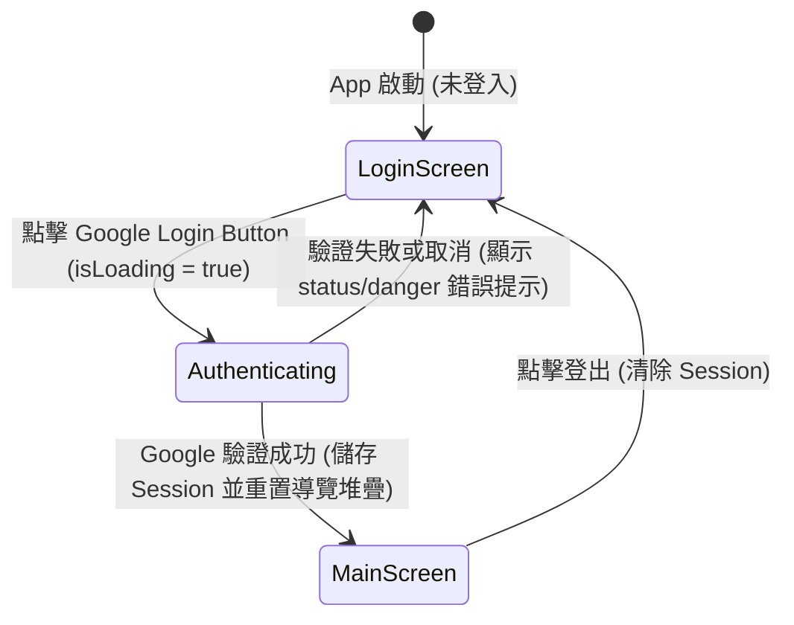
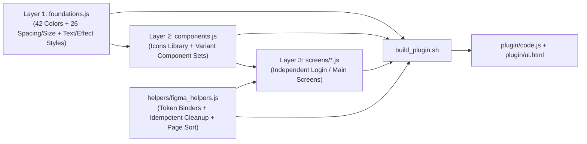

# TodoList — Figma Design-as-Code & AI-Ready Design System

[](./LICENSE)

> **Documentation**: Product Specs [`SPEC.md`](./SPEC.md) | Architecture & Toolchain [`DESIGN.md`](./DESIGN.md) | AI Agent Guidelines [`AGENTS.md`](./AGENTS.md)

This repository demonstrates how to combine **Figma Design-as-Code (via a local Figma Plugin)** with **Dual-Core Specifications (Figma for Visuals + Markdown for Behavior)** so that your entire design system lives in Git and enables AI Agents (with Figma MCP) to generate 1:1 cross-platform UI (iOS SwiftUI, Android Jetpack Compose, Flutter) with zero hardcoded values.

- **Figma File Link**: [TodoList Figma Design](https://www.figma.com/design/{figmaFileKey}/MCPTest)
- **File Key**: `{figmaFileKey}`
- **Full Tutorial (English / Medium-Ready)**: Jump to [Section 8: Hands-On Tutorial](#8-hands-on-tutorial-building-an-ai-ready-figma-design-system-with-design-as-code) for a step-by-step walkthrough.

### 📸 Preview (Generated by `TodoList FigmaDesigner` Plugin)

| `Components` Page (Icons & Reusable Variants) | `Main` Page (Auto-Layout Screen) |
| :---: | :---: |
|  |  |

### 🚀 Quick Start

1. **Build the local Figma Plugin**:
   ```bash
   sh FigmaDesigner/build_plugin.sh && node --check FigmaDesigner/plugin/code.js
   ```
   *(Optional: Run `sh FigmaDesigner/build_plugin.sh --watch` for automatic rebuilds while editing scripts.)*
2. **Import into Figma Desktop**:
   - Open an empty Figma Design file and go to `Plugins` ➔ `Development` ➔ `Import plugin from manifest...`, then select [`FigmaDesigner/manifest.json`](./FigmaDesigner/manifest.json).
   - Run **TodoList FigmaDesigner** and click **`🚀 Rebuild All`** (`Foundations ➔ Components ➔ Screens`) to generate the entire design system and screens in seconds.
3. **Configure `{option}` Placeholders (Optional for App Implementation)**:
   - All project-specific identifiers and credentials in this template are replaced with `{option}` placeholders (e.g., `{firebaseProjectId}`, `{packageName}`, `{bundleId}`, `{figmaFileKey}`). Replace them with your own values, then run `./check_env.sh && ./setup_firebase.sh` before starting native/Flutter development.

---

## 1. Figma Design System 核心架構與分工原則

在 Figma 最新官方標準（如 Simple Design System）中，設計基礎（Foundations）依資料結構分為 **`Variables`（單一純量值）** 與 **`Styles`（複合結構 `struct`）** 兩大類：

| 類別 | 資料結構概念 | 負責管理的項目 | Figma 內對應集合 / 面板 |
| :--- | :--- | :--- | :--- |
| **`Variables`（變數）** | 基本型別 (`Primitive`)<br/>`Key -> 單一數值` | 1. **單一純色（Solid Colors）**<br/>2. **間距（Spacing / Gap / Padding）**<br/>3. **圓角（Corner Radius）**<br/>4. **邊框粗細與元件尺寸（Stroke & Size）** | • `ColorCollection` (42 個變數)<br/>• `SpacingCollection` (26 個變數) |
| **`Styles`（樣式）** | 結構體 (`struct`)<br/>`Key -> 多屬性組合包` | 1. **文字排版（Text Styles）**：字體 + 字重 + 大小 + 行高 + 字距<br/>2. **視覺特效（Effect Styles）**：陰影 (`Drop/Inner Shadow`) + 模糊 (`Blur`)<br/>3. **複合填色（Color Styles）**：漸層色 (`Gradient`)、多層材質疊加 | • `Text styles` (12 個字級)<br/>• `Effect styles` (`Elevation` 3 個層級)<br/>• `Color styles` (僅漸層卡面使用) |

> [!IMPORTANT]
> **為什麼單一純色不建在 `Color Styles`？**
> 單一純色一律使用 `Color Variables`，以支援 **Scopes（屬性選擇器過濾）** 與 **Code Syntax（`Color.bgSurface` / `colorBgSurface`）**。只有當填色是「漸層（Gradients）」或「多層圖片材質疊加」時，才使用 `Color Styles`。

---

## 2. `ColorCollection` — 語意化色彩變數 (Light / Dark Mode)

- **Collection ID**：`VariableCollectionId:71:22`
- **群組結構**：因應 Figma Starter 方案單一 Mode 限制，於 `ColorCollection` 內以 `light/...`（21 個）與 `dark/...`（21 個）雙群組管理，並將兩者的 **Code Syntax 統一映射至同一個語意 Token 名稱**。

### 2.1 色彩變數總表（共 42 個變數）

| 分類 | Light 變數名稱 | Light 色碼 | Dark 變數名稱 | Dark 色碼 | Scopes | 用途說明 | Web / iOS / Android Code Syntax |
| :--- | :--- | :---: | :--- | :---: | :--- | :--- | :--- |
| **Background & Surface** | `light/bg/canvas` | `#F5F7FA` | `dark/bg/canvas` | `#0B0F17` | `FRAME_FILL`, `SHAPE_FILL` | App 頁面主背景 | `var(--color-bg-canvas)`<br/>`Color.bgCanvas`<br/>`colorBgCanvas` |
| | `light/bg/surface` | `#FFFFFF` | `dark/bg/surface` | `#151C28` | `FRAME_FILL`, `SHAPE_FILL` | 卡片、待辦列、按鈕容器底色 | `var(--color-bg-surface)`<br/>`Color.bgSurface`<br/>`colorBgSurface` |
| | `light/bg/elevated` | `#FFFFFF` | `dark/bg/elevated` | `#1E2736` | `FRAME_FILL`, `SHAPE_FILL` | 彈窗、Bottom Sheet、浮層底色 | `var(--color-bg-elevated)`<br/>`Color.bgElevated`<br/>`colorBgElevated` |
| | `light/bg/subtle` | `#EEF2F6` | `dark/bg/subtle` | `#253042` | `FRAME_FILL`, `SHAPE_FILL` | 次要區塊、輸入框、狀態標籤底色 | `var(--color-bg-subtle)`<br/>`Color.bgSubtle`<br/>`colorBgSubtle` |
| **Brand & Action** | `light/brand/primary` | `#0066FF` | `dark/brand/primary` | `#3385FF` | `FRAME_FILL`, `SHAPE_FILL`, `TEXT_FILL`, `STROKE_COLOR` | 主品牌色（Primary CTA、主操作按鈕） | `var(--color-brand-primary)`<br/>`Color.brandPrimary`<br/>`colorBrandPrimary` |
| | `light/brand/primary-pressed` | `#0052CC` | `dark/brand/primary-pressed` | `#66A3FF` | `FRAME_FILL`, `SHAPE_FILL` | 主按鈕按壓 / Active 狀態 | `var(--color-brand-primary-pressed)`<br/>`Color.brandPrimaryPressed`<br/>`colorBrandPrimaryPressed` |
| | `light/brand/secondary` | `#E6F0FF` | `dark/brand/secondary` | `#122B54` | `FRAME_FILL`, `SHAPE_FILL` | 次要品牌淺底色（標籤、徽章） | `var(--color-brand-secondary)`<br/>`Color.brandSecondary`<br/>`colorBrandSecondary` |
| | `light/brand/accent` | `#F59E0B` | `dark/brand/accent` | `#FBBF24` | `FRAME_FILL`, `SHAPE_FILL`, `TEXT_FILL` | 強調標記、重點提示金黃強調色 | `var(--color-brand-accent)`<br/>`Color.brandAccent`<br/>`colorBrandAccent` |
| **Text & Icon** | `light/text/primary` | `#111827` | `dark/text/primary` | `#F9FAFB` | `TEXT_FILL`, `SHAPE_FILL` | 主要文字、待辦標題、頁面主標 | `var(--color-text-primary)`<br/>`Color.textPrimary`<br/>`colorTextPrimary` |
| | `light/text/secondary` | `#4B5563` | `dark/text/secondary` | `#9CA3AF` | `TEXT_FILL`, `SHAPE_FILL` | 次要說明、到期日、輔助資訊 | `var(--color-text-secondary)`<br/>`Color.textSecondary`<br/>`colorTextSecondary` |
| | `light/text/muted` | `#9CA3AF` | `dark/text/muted` | `#6B7280` | `TEXT_FILL`, `SHAPE_FILL` | Placeholder、停用狀態文字 | `var(--color-text-muted)`<br/>`Color.textMuted`<br/>`colorTextMuted` |
| | `light/text/on-brand` | `#FFFFFF` | `dark/text/on-brand` | `#FFFFFF` | `TEXT_FILL`, `SHAPE_FILL` | 品牌主色按鈕上的反白文字與圖示 | `var(--color-text-on-brand)`<br/>`Color.textOnBrand`<br/>`colorTextOnBrand` |
| **Border & Divider** | `light/border/default` | `#E5E7EB` | `dark/border/default` | `#2E3A4E` | `STROKE_COLOR` | 一般卡片與輸入框預設外框 | `var(--color-border-default)`<br/>`Color.borderDefault`<br/>`colorBorderDefault` |
| | `light/border/focus` | `#0066FF` | `dark/border/focus` | `#3385FF` | `STROKE_COLOR` | 聚焦中輸入框外框 | `var(--color-border-focus)`<br/>`Color.borderFocus`<br/>`colorBorderFocus` |
| | `light/border/divider` | `#F3F4F6` | `dark/border/divider` | `#1F2937` | `STROKE_COLOR`, `FRAME_FILL`, `SHAPE_FILL` | 列表與區塊分隔線 | `var(--color-border-divider)`<br/>`Color.borderDivider`<br/>`colorBorderDivider` |
| **Semantic Status** | `light/status/success` | `#10B981` | `dark/status/success` | `#34D399` | `TEXT_FILL`, `SHAPE_FILL`, `FRAME_FILL`, `STROKE_COLOR` | 已完成狀態 (`DONE`)、成功提示 | `var(--color-status-success)`<br/>`Color.statusSuccess`<br/>`colorStatusSuccess` |
| | `light/status/success-bg` | `#ECFDF5` | `dark/status/success-bg` | `#064E3B` | `FRAME_FILL`, `SHAPE_FILL` | `DONE` 狀態膠囊 / 成功橫幅底色 | `var(--color-status-success-bg)`<br/>`Color.statusSuccessBg`<br/>`colorStatusSuccessBg` |
| | `light/status/warning` | `#F59E0B` | `dark/status/warning` | `#FBBF24` | `TEXT_FILL`, `SHAPE_FILL`, `FRAME_FILL`, `STROKE_COLOR` | 進行中狀態 (`IN PROGRESS`)、提醒 | `var(--color-status-warning)`<br/>`Color.statusWarning`<br/>`colorStatusWarning` |
| | `light/status/warning-bg` | `#FFFBEB` | `dark/status/warning-bg` | `#78350F` | `FRAME_FILL`, `SHAPE_FILL` | `IN PROGRESS` 狀態膠囊 / 提醒橫幅底色 | `var(--color-status-warning-bg)`<br/>`Color.statusWarningBg`<br/>`colorStatusWarningBg` |
| | `light/status/danger` | `#EF4444` | `dark/status/danger` | `#F87171` | `TEXT_FILL`, `SHAPE_FILL`, `FRAME_FILL`, `STROKE_COLOR` | 錯誤警示、驗證失敗、危險操作 | `var(--color-status-danger)`<br/>`Color.statusDanger`<br/>`colorStatusDanger` |
| | `light/status/danger-bg` | `#FEF2F2` | `dark/status/danger-bg` | `#7F1D1D` | `FRAME_FILL`, `SHAPE_FILL` | 錯誤 / 異常警示橫幅底色 | `var(--color-status-danger-bg)`<br/>`Color.statusDangerBg`<br/>`colorStatusDangerBg` |

### 2.2 跨平台（iOS / Android / Flutter）Light / Dark 自動切換對應方式

在 Mobile UI 程式碼中，View 永遠只呼叫**單一語意 Token 名稱**（如 iOS 的 `Color.bgCanvas`、Android 的 `colorBgCanvas`），不寫 `if (isDark)` 判斷：

```
Figma 設計端 (Starter 方案雙群組)         Code Syntax 橋接          Mobile 程式碼端 (依系統深淺色自動切換)
┌─────────────────────────────┐
│ light/bg/canvas (#F5F7FA)   │ ───┐
└─────────────────────────────┘    ├──>  iOS: Color.bgCanvas       ──> Light 顯示 #F5F7FA / Dark 顯示 #0B0F17
┌─────────────────────────────┐    │     Android: colorBgCanvas
│ dark/bg/canvas  (#0B0F17)   │ ───┘
└─────────────────────────────┘
```

---

## 3. `SpacingCollection` — 間距、圓角、邊框與尺寸變數

- **Collection ID**：`VariableCollectionId:78:15`
- **變數總數**：共 **26 個** `FLOAT` 變數（分為 `spacing`、`radius`、`stroke`、`size` 四大群組）

| 群組 | 變數名稱 | 數值 (px) | 綁定範圍 (Scope) | 用途說明 | Web / iOS / Android Code Syntax |
| :--- | :--- | :---: | :--- | :--- | :--- |
| **`spacing`** | `spacing/none` | `0` | `GAP` | 無間距 | `var(--spacing-none)` / `Spacing.none` / `spacingNone` |
| | `spacing/2xs` | `2` | `GAP` | 極小文字間距 | `var(--spacing-2xs)` / `Spacing.xxs` / `spacing2xs` |
| | `spacing/xs` | `4` | `GAP` | 標籤內距、標題與副標間距 | `var(--spacing-xs)` / `Spacing.xs` / `spacingXs` |
| | `spacing/sm` | `8` | `GAP` | 圖示與文字間距、緊湊內距 | `var(--spacing-sm)` / `Spacing.sm` / `spacingSm` |
| | `spacing/md` | `12` | `GAP` | 一般元件內部間距、中型按鈕垂直內距 | `var(--spacing-md)` / `Spacing.md` / `spacingMd` |
| | `spacing/lg` | `16` | `GAP` | 標準卡片內距、畫面左右留邊、列表列內距 | `var(--spacing-lg)` / `Spacing.lg` / `spacingLg` |
| | `spacing/xl` | `20` | `GAP` | 寬敞卡片內距、區塊間距 | `var(--spacing-xl)` / `Spacing.xl` / `spacingXl` |
| | `spacing/2xl` | `24` | `GAP` | Bottom Sheet 內距、大區塊間距 | `var(--spacing-2xl)` / `Spacing.xxl` / `spacing2xl` |
| | `spacing/3xl` | `32` | `GAP` | 大型跨區塊間距 | `var(--spacing-3xl)` / `Spacing.xxxl` / `spacing3xl` |
| | `spacing/4xl` | `48` | `GAP` | 頁面頂部 / 底部大留白 | `var(--spacing-4xl)` / `Spacing.xxxxl` / `spacing4xl` |
| **`radius`** | `radius/none` | `0` | `CORNER_RADIUS` | 直角 | `var(--radius-none)` / `Radius.none` / `radiusNone` |
| | `radius/xs` | `4` | `CORNER_RADIUS` | 小標籤 (Badge / Tag) 圓角 | `var(--radius-xs)` / `Radius.xs` / `radiusXs` |
| | `radius/sm` | `8` | `CORNER_RADIUS` | 小按鈕、輸入框、Chip 圓角 | `var(--radius-sm)` / `Radius.sm` / `radiusSm` |
| | `radius/md` | `12` | `CORNER_RADIUS` | 標準主按鈕、列表卡片圓角 | `var(--radius-md)` / `Radius.md` / `radiusMd` |
| | `radius/lg` | `16` | `CORNER_RADIUS` | 大型資訊卡片、大型容器圓角 | `var(--radius-lg)` / `Radius.lg` / `radiusLg` |
| | `radius/xl` | `24` | `CORNER_RADIUS` | Bottom Sheet 與彈窗圓角 | `var(--radius-xl)` / `Radius.xl` / `radiusXl` |
| | `radius/full` | `9999` | `CORNER_RADIUS` | 膠囊按鈕 (Pill)、圓形頭像與圖示底框 | `var(--radius-full)` / `Radius.full` / `radiusFull` |
| **`stroke`** | `stroke/thin` | `1` | `STROKE_FLOAT` | 一般卡片邊框、分隔線粗細 | `var(--stroke-thin)` / `Stroke.thin` / `strokeThin` |
| | `stroke/medium` | `1.5` | `STROKE_FLOAT` | 強調邊框 | `var(--stroke-medium)` / `Stroke.medium` / `strokeMedium` |
| | `stroke/thick` | `2` | `STROKE_FLOAT` | 聚焦中輸入框邊框粗細 | `var(--stroke-thick)` / `Stroke.thick` / `strokeThick` |
| **`size`** | `size/icon-sm` | `16` | `WIDTH_HEIGHT` | 小型狀態或箭頭圖示尺寸 | `var(--size-icon-sm)` / `Size.iconSm` / `sizeIconSm` |
| | `size/icon-md` | `20` | `WIDTH_HEIGHT` | 按鈕與輸入框內嵌圖示尺寸 | `var(--size-icon-md)` / `Size.iconMd` / `sizeIconMd` |
| | `size/icon-lg` | `24` | `WIDTH_HEIGHT` | 導覽列與快捷功能圖示尺寸 | `var(--size-icon-lg)` / `Size.iconLg` / `sizeIconLg` |
| | `size/control-sm` | `36` | `WIDTH_HEIGHT` | 小型按鈕 / 標籤高度 | `var(--size-control-sm)` / `Size.controlSm` / `sizeControlSm` |
| | `size/control-md` | `44` | `WIDTH_HEIGHT` | 標準觸控按鈕 / 輸入框高度 | `var(--size-control-md)` / `Size.controlMd` / `sizeControlMd` |
| | `size/control-lg` | `52` | `WIDTH_HEIGHT` | 主行動按鈕 (Primary CTA) 高度 | `var(--size-control-lg)` / `Size.controlLg` / `sizeControlLg` |

---

## 4. `Text Styles` — 文字排版樣式 (`struct`)

`Text Style` 是由 **Font Family + Font Style (Weight) + Font Size + Line Height + Letter Spacing** 組成的複合結構，讓設計師與工程師一鍵套用整套排版設定（`Amount/*` 亦預留供統計／數據展示擴充使用）：

| 分類 | Text Style 名稱 | 字體與字重 (`fontName`) | 字號 (`size`) | 行高 (`lineHeight`) | 字距 (`letterSpacing`) | 用途說明 |
| :--- | :--- | :--- | :---: | :---: | :---: | :--- |
| **`Amount`**<br/>*(預留數據統計專用)* | `Amount/Hero` | `Inter Bold` | `36px` | `44px` | `-1.0px` | 主數據 / 英雄區大型數字 |
| | `Amount/Large` | `Inter Bold` | `28px` | `36px` | `-0.5px` | 統計卡片大數字 |
| | `Amount/Medium` | `Inter Semi Bold` | `20px` | `28px` | `-0.2px` | 小計、摘要卡片數字 |
| | `Amount/Inline` | `Inter Semi Bold` | `16px` | `24px` | `0px` | 列表行內右側強調數字 |
| **`Heading`**<br/>*(標題層級)* | `Heading/H1` | `Inter Bold` | `24px` | `32px` | `-0.5px` | 頁面主標題 |
| | `Heading/H2` | `Inter Semi Bold` | `20px` | `28px` | `-0.3px` | 區塊標題、Bottom Sheet 標題 |
| | `Heading/H3` | `Inter Semi Bold` | `17px` | `24px` | `-0.2px` | 卡片標題、導覽列標題 |
| **`Body`**<br/>*(內文層級)* | `Body/Large` | `Inter Regular` | `16px` | `24px` | `0px` | 主要內文、待辦標題內文 |
| | `Body/Medium` | `Inter Regular` | `14px` | `20px` | `0px` | 次要說明、彈窗內文、備註 |
| **`Label`**<br/>*(按鈕與標籤)* | `Label/Large` | `Inter Semi Bold` | `16px` | `24px` | `0px` | 主行動按鈕 (Primary CTA) 文字 |
| | `Label/Medium` | `Inter Medium` | `14px` | `20px` | `0.1px` | 次要按鈕、Tab 標籤、輸入框標題 |
| **`Caption`**<br/>*(輔助小字)* | `Caption/Small` | `Inter Regular` | `12px` | `16px` | `0.2px` | 到期日時間戳記、輔助提示、狀態標籤文字 |

---

## 5. `Effect Styles` — Z 軸立體高度 (Elevation) 與視覺特效 (`struct`)

如果說 `SpacingCollection` 控制的是平面的 **`X / Y` 軸距離**，那 **`Effect Styles` 控制的就是立體的 `Z` 軸高度（Elevation）與模糊效果**。

### 5.1 Figma 支援的 4 大 `Effect` 特效種類表

為什麼 Figma 把這個分類叫做 **`Effect styles`（特效樣式）** 而不是 `Shadow styles`？因為 `Effect` 總共支援以下 **4 種視覺特效**：

| 特效種類 (`Effect Type`) | 視覺效果 | 在 App 中的常見用途 | 對應 iOS (SwiftUI) |
| :--- | :--- | :--- | :--- |
| **1. `Drop shadow`**<br/>（外陰影 — 佔 80%） | 往外投射陰影，產生**「浮起來」**的立體高度 | 列表卡片 (`Card`)、懸浮按鈕 (`Floating`)、彈窗 (`Modal`) | `.shadow(...)` |
| **2. `Inner shadow`**<br/>（內陰影） | 往框內投射陰影，產生**「凹陷進去」**的感覺 | 輸入槽凹陷感、立體按鈕按壓（Pressed）時的微凹陷效果 | 自訂內陰影組合 |
| **3. `Background blur`**<br/>（背景毛玻璃） | 讓它背後的畫面變模糊（iOS 磨砂毛玻璃） | **頂部固定導覽列**、**底部懸浮 Tab Bar**、**半透明玻璃浮層** | `.background(.ultraThinMaterial)` |
| **4. `Layer blur`**<br/>（圖層本身模糊） | 把這個物件自己直接做高斯模糊 | 隱私遮罩模式時將敏感文字或數值模糊化防偷看 | `.blur(radius: 8)` |

### 5.2 目前已建立的 `Elevation` 外陰影層級（皆使用 `Drop shadow`）

| Effect Style 名稱 | 特效種類 | Z 軸高度 | 實際套用場景 | 對應 iOS / Android 程式碼 |
| :--- | :---: | :---: | :--- | :--- |
| **`Elevation/Card`** | `Drop shadow` | 低（微浮起） | **登入按鈕、待辦清單卡片、一般區塊**（讓白色卡片柔和地浮在淺灰底色上） | iOS: `.shadow(color: .black.opacity(0.06), radius: 4, x: 0, y: 2)`<br/>Android: `Modifier.shadow(2.dp)` |
| **`Elevation/Floating`** | `Drop shadow` | 中（懸浮層） | **底部懸浮按鈕 (FAB)**、**頂部 Toast 通知** | iOS: `.shadow(color: .black.opacity(0.12), radius: 12, x: 0, y: 6)`<br/>Android: `Modifier.shadow(6.dp)` |
| **`Elevation/Modal`** | `Drop shadow` | 高（最頂層） | **`AddTaskSheet` Bottom Sheet**、**彈窗 (Dialog)** | iOS: `.shadow(color: .black.opacity(0.20), radius: 24, x: 0, y: 12)`<br/>Android: `Modifier.shadow(16.dp)` |

---

## 6. AI Agent 驅動開發工作流：Figma 靜態畫面 ＋ Markdown 流程規格

在結合 **Figma MCP + Agent Skills / Markdown Spec** 的開發文化下，不再於 Figma `Prototype` 模式中拉大量跳轉連線，而是採行 **雙核心唯一真相來源（Dual Source of Truth）**：

### 6.1 雙核心職責分工

| 維度 | 唯一真相來源 (Source of Truth) | 負責定義的內容 | AI Agent 如何讀取與轉譯？ |
| :--- | :--- | :--- | :--- |
| **1. 長什麼樣子？**<br/>*(What it looks like)* | 🎨 **Figma Design**<br/>(`MCPTest`) | • **Tokens**：`ColorCollection`、`SpacingCollection`、`Text/Effect Styles`<br/>• **Components**：獨立 `Components` Page 內的 `Icons Library` 與共用元件<br/>• **Key Screens**：`Login`、`Main` 等關鍵靜態畫面（全面使用 `Frame` + `Auto Layout`） | 透過 **Figma MCP** 讀取結構樹、Auto Layout (`Vertical`/`Horizontal`、`Fixed`/`Hug`/`Fill`) 與 Token Code Syntax，1:1 生成 SwiftUI / Jetpack Compose / Flutter UI |
| **2. 怎麼運作與跳轉？**<br/>*(How it works)* | 📄 **Codebase Markdown**<br/>(`SPEC.md` / `DESIGN.md` + `SKILL.md`) | • **User Flow & Navigation**：畫面跳轉條件、路由堆疊規則<br/>• **State & Logic**：狀態機 (`idle`/`loading`/`error`/`authenticated`) 與 Firestore / Auth 串接<br/>• **Architecture**：各平台分層規範、TDD 與 ADRs | 直接讀取專案目錄下的 Markdown 規格與 Agent Skill，自動生成業務邏輯、狀態管理與單元測試 |

### 6.2 實際開發運作流程（3 步閉環）

1. **Step 1 — 在 Figma 端（極簡化視覺定義）**：
   - 只畫好 **`Login`** 與 **`Main`** 等乾淨的關鍵靜態畫面（Keyframes），並將可重用元件統一收納於獨立的 **`Components`** Page（如 `Icons Library`，對應本地向量圖示庫 `FigmaDesigner/assets/icons/*.svg`）。
   - 所有容器皆使用 **`Frame` + `Auto Layout` (`Shift + A`)**，並綁定 `ColorCollection`、`SpacingCollection`、`Text Styles` 與 `Effect Styles`，完全不需在 Figma 拉 `Prototype` 互動連線。
   - 整套 Figma 設計（Collections、Styles、Components、Screens）皆透過 `FigmaDesigner/*.js` 腳本進行 **Design-as-Code Git 版本控制**。
2. **Step 2 — 在專案目錄 `./MCPTest` 端（Markdown 定義狀態與流程）**：
   - 於 Markdown 規格中透過文字與 Mermaid 狀態圖明確定義畫面跳轉、例外處理與狀態流轉：



3. **Step 3 — 交由 AI Agent 一鍵生成跨平台 App**：
   - AI Agent 讀取本 `README.md` 的 Design Token 映射表與 [SPEC.md](./SPEC.md) / [DESIGN.md](./DESIGN.md)，搭配 Figma 的 `Login` 與 `Main` 頁面結構，即可在 **零寫死色碼與座標（Zero Hardcoding）**、**自動支援 Light / Dark Mode** 的前提下，依各平台規範實作 iOS (SwiftUI)、Android (Jetpack Compose) 與 Flutter 的 UI 視圖、業務邏輯與單元測試。

---

## 7. Figma 頁面與可重用元件結構 (`Pages & Components`)

> **裝置與方向基準**：本設計系統以 **Phone Only（僅支援手機）** 與 **Portrait / Portrait Upside Down（直向與倒立直向）** 為唯一規格基準。`393 × 852` 僅為 Figma 靜態畫布的參考視窗（Reference Frame）尺寸，實際三平台 App 須透過 Auto Layout 自適應撐滿所有尺寸的直向手機螢幕，不得鎖死視窗寬高。

### 7.1 `Components` Page（獨立元件庫頁面）

1. **`Icons Library`**：收納 20 個標準向量 Icon Components，1:1 對應本地 `FigmaDesigner/assets/icons/*.svg`：
   - 登入與通用：`Icon/google` (`ic_google.svg`)、`Icon/apple` (`ic_apple.svg`)、`Icon/mail`、`Icon/lock`、`Icon/eye`、`Icon/eye-off`、`Icon/face-id`、`Icon/trash` (`ic_trash.svg` — 左滑刪除動作按鈕圖示)
   *(註：按鈕 Loading Indicator 不使用靜態 SVG，三平台統一載入 `shared/animations/circle-loader-*.json` Lottie 動畫。)*
   - 支付與導覽：`Icon/qr-scan`、`Icon/barcode`、`Icon/transfer`、`Icon/top-up`、`Icon/wallet`、`Icon/credit-card`、`Icon/bell`、`Icon/receipt`、`Icon/chevron-right`
   - 待辦狀態專用：`Icon/status-todo` (`ic_status_todo.svg`)、`Icon/status-in-progress` (`ic_status_in_progress.svg`)、`Icon/status-done` (`ic_status_done.svg`)
2. **`❖ ToDoCellItem` Component Set（單行水平列表項元件）**：
   - **Auto Layout 結構**：`Horizontal Auto Layout (SPACE_BETWEEN)` ➔ **`[ Title + Due Date (Gap: spacing/sm = 8px) ]` + `Spacer` + `[ Status Label | Status Icon ]`**
   - **Component Text Properties**：`Title`（預設套用 `Label/Medium`、`light/text/primary`）、`Due Date`（預設套用 `Caption/Small`、`light/text/secondary`）
   - **3 種 `Status` Variants**：
     - `Status=TODO`：膠囊底色 `light/bg/subtle`、文字與圖示 `light/text/secondary` + `Icon/status-todo`
     - `Status=IN PROGRESS`：膠囊底色 `light/status/warning-bg`、文字與圖示 `light/status/warning` + `Icon/status-in-progress`
     - `Status=DONE`：膠囊底色 `light/status/success-bg`、文字與圖示 `light/status/success` + `Icon/status-done`
3. **`❖ AppButton` Component Set（共用按鈕元件）**：
   - **高度 / 圓角 / 內距**：高度綁定 `size/control-md` (`44px`)、圓角綁定 `radius/md` (`12px`)、左右內距綁定 `spacing/lg` (`16px`)。
   - **2 種 `Style` Variants**：
     - `Style=Primary`：底色 `light/brand/primary` (`#0066FF`)、文字 `light/text/on-brand` (`#FFFFFF`)、字級 `Label/Large`
     - `Style=Secondary`：底色 `light/bg/subtle` (`#EEF2F6`)、文字 `light/text/secondary` (`#4B5563`)、字級 `Label/Medium`
4. **`❖ AppTextField` Component Set（共用輸入框元件）**：
   - **高度 / 圓角 / 內距**：輸入框高度綁定 `size/control-md` (`44px`)、圓角綁定 `radius/sm` (`8px`)、左右內距綁定 `spacing/md` (`12px`)，上方 `Field Label` 與輸入框間距綁定 `spacing/xs` (`4px`)。
   - **2 種 `State` Variants**：
     - `State=Default`：底色 `light/bg/subtle`、邊框 `light/border/default` + `stroke/thin` (`1px`)、文字 `light/text/muted`
     - `State=Focused`：底色 `light/bg/surface`、邊框 `light/border/focus` + `stroke/thick` (`2px`)、文字 `light/text/primary`
5. **`❖ AddTaskSheet` Component（新增待辦事項 Bottom Sheet 複合元件）**：
   - **外框**：`Vertical Auto Layout`，底色綁定 `light/bg/elevated`、頂部圓角綁定 `radius/xl` (`24px`)、陰影套用 `Elevation/Modal`、內距綁定 `spacing/2xl` (`24px`)、間距綁定 `spacing/lg` (`16px`)。
   - **內部巢狀組裝（Nested Instances）**：
     - 頂部 `Drag Handle` (`40 × 4`, `radius/full`, `light/border/default`)
     - 標題 `Sheet Title` (`"New Todo Item"`, `Heading/H2`, `light/text/primary`)
     - 2 個 `◇ AppTextField` Instances（`"Task Title"` 與 `"Due Date"`）
     - 底部 `Action Row`：水平排列 2 個 `◇ AppButton` Instances（左側 `Style=Secondary` `"Cancel"`，右側 `Style=Primary` `"Add Task"`）

### 7.2 `Login` Page（登入頁面）

- **`Login Screen` (`393 × 852`)**：`Vertical Auto Layout`，水平與垂直皆為 `CENTER` 正中心對齊，底色綁定 `light/bg/canvas`，內距綁定 `spacing/2xl` (`24px`)。
- **`Google Login Button`**：`Horizontal Auto Layout`，寬度 `FILL`，高度綁定 `size/control-lg` (`52px`)，圓角綁定 `radius/md` (`12px`)，內嵌 `◇ Icon/google` Instance 與 `"Continue with Google"`（`Label/Large`）。

### 7.3 `Main` Page（主畫面）

- **`Main Screen` (`393 × 852`)**：`Vertical Auto Layout`，底色綁定 `light/bg/canvas`，左右內距綁定 `spacing/lg` (`16px`)，底部內距綁定 `spacing/3xl` (`32px`)。
- **`TopNavBar`**：`Horizontal Auto Layout (SPACE_BETWEEN)`，左側為 `NavTitle`（`"My Todo List"`，`Heading/H1`），右側為 `AddButton`（`"+ Add"`，底色綁定 `light/brand/primary`，高度綁定 `size/control-sm = 36px`）。
- **`ListView`**：`Vertical Auto Layout`（寬高皆為 `FILL`，間距綁定 `spacing/md = 12px`），內部放置 **`◇ ToDoCellItem` Instances**（預設 3 筆：`Buy groceries` / `Nov 20` `TODO`、`Prepare project slides` / `Nov 22` `IN PROGRESS`、`Book dentist appointment` / `Nov 18` `DONE`），點擊右上角 `+ Add` 彈出 `AddTaskSheet`，點擊每列右側狀態膠囊按鈕循環切換 `TODO ➔ IN PROGRESS ➔ DONE ➔ TODO`。
- **`LogOut` Button**：配置於 `Main Screen` 最下方（`◇ AppButton` `Style=Secondary` Instance，文字 `"LogOut"` 套用 `Label/Large` + `light/text/primary`，寬度 `FILL`，距畫面底部 `spacing/3xl = 32px`），點擊後立即登出回到 `Login Screen`。

---

## 8. Hands-On Tutorial: Building an AI-Ready Figma Design System with Design-as-Code

> This section is structured as a complete, Medium-ready walkthrough explaining the architecture, local plugin workflow, and how to pair Figma Design-as-Code with AI coding agents.

### 8.1 Why "Screenshot-to-Code" Fails in Production

Feeding raw Figma screenshots to an AI coding assistant usually breaks down in three ways:
1. **Hardcoded Magic Numbers**: The AI guesses hex codes (`#0066FF`) and spacing (`padding: 15px`) instead of binding to semantic Design Tokens.
2. **Broken Light/Dark Semantics**: A screenshot shows only one appearance. The AI cannot tell whether a white card should map to `bg/surface` or `bg/elevated` in Dark Mode.
3. **Zero Version Control for Design**: Manually dragged layers in Figma cannot be code-reviewed, diffed in Git, or regenerated deterministically.

**The Fix — Design-as-Code**: Instead of drawing layers manually, write your Design System as modular JavaScript using the Figma Plugin API. Every color, radius, spacing, text style, variant, and Auto Layout constraint is codified, versioned in Git, and exposed via **Code Syntax** so AI agents (through **Figma MCP + `AGENTS.md`**) can read the exact structure and generate pixel-accurate UI.

---

### 8.2 Three-Layer Design-as-Code Architecture

[`FigmaDesigner/`](./FigmaDesigner) separates foundations, components, and screens into three clean layers:



1. **Layer 1 — `foundations.js` (Variables & Styles)**
   - Creates `ColorCollection` (42 Light/Dark semantic tokens) and `SpacingCollection` (26 `spacing`, `radius`, `stroke`, and `size` tokens) via `figma.variables.createVariableCollection`.
   - Assigns **`scopes`** (e.g., `FRAME_FILL`, `TEXT_FILL`, `CORNER_RADIUS`, `GAP`) and platform-specific **`Code Syntax`** (e.g., `var(--color-bg-canvas)`, `Color.bgCanvas`, `colorBgCanvas`).
   - Registers 12 `Text Styles` and 3 `Elevation/*` `Effect Styles`.
2. **Layer 2 — `components.js` (Dedicated `Components` Page)**
   - Imports vector assets from `FigmaDesigner/assets/icons/*.svg` into an `Icons Library`.
   - Builds reusable Component Sets (`ToDoCellItem`, `AppButton`, `AppTextField`) with explicit **Variants** (`Status=TODO | IN PROGRESS | DONE`, `Style=Primary | Secondary`, `State=Default | Focused`) and nested component instances (`AddTaskSheet`).

   
   *Figure 1: `Components` page generated automatically by `components.js` (`Icons Library`, `ToDoCellItem`, `AppButton`, `AppTextField`, and `AddTaskSheet`).*

3. **Layer 3 — `screens/*.js` + `helpers/figma_helpers.js` (Idempotent Screen Builders)**
   - Each screen lives in its own file (`screens/login.js`, `screens/main.js`) and calls `createFigmaDesignerContext()` for shared helpers:
     - `ctx.bindFill` / `ctx.bindStroke` / `ctx.bindFloat`: Binds node properties directly to Figma Variables (no hardcoded numbers).
     - `ctx.applyTextStyle` / `ctx.applyEffectStyle`: Applies shared typography and elevation styles.
     - `ctx.cleanupEmptyPage1AndSort()`: Removes leftover empty `Page 1` frames and orders pages cleanly.
   - Before drawing, each screen script removes stale frames with the same name, making every run **100% idempotent**—you can re-run the plugin endlessly without creating duplicate layers.

   
   *Figure 2: `Main Screen` generated by `screens/main.js` using Auto Layout, semantic tokens, and `ToDoCellItem` / `AppButton` instances.*

---

### 8.3 Automated Plugin Bundling & Watch Mode

To avoid pasting scripts manually into Figma's Developer Console, [`FigmaDesigner/build_plugin.sh`](./FigmaDesigner/build_plugin.sh) automates bundling and UI generation:

1. **Build and syntax-check once**:
   ```bash
   sh FigmaDesigner/build_plugin.sh && node --check FigmaDesigner/plugin/code.js
   ```
   The script merges `foundations.js`, `components.js`, `helpers/figma_helpers.js`, and every file in `screens/*.js` into `FigmaDesigner/plugin/code.js`, while dynamically generating `FigmaDesigner/plugin/ui.html` with a button for each screen and a live build timestamp.
2. **Watch mode for rapid iteration**:
   ```bash
   sh FigmaDesigner/build_plugin.sh --watch
   ```
   Any edit to your Design-as-Code scripts automatically triggers a rebuild within 1 second.
3. **Run inside Figma Desktop**:
   - Open Figma Desktop ➔ `Plugins` ➔ `Development` ➔ `Import plugin from manifest...` ➔ pick [`FigmaDesigner/manifest.json`](./FigmaDesigner/manifest.json).
   - Click **`🚀 Rebuild All`** for a full rebuild (`Foundations ➔ Components ➔ Screens`), or click an individual screen button to redraw just one page.

---

### 8.4 Hands-On: Adding a New Screen in 30 Seconds

Drop a new file into `FigmaDesigner/screens/`—for example `settings.js`—using the standard IIFE wrapper:

```javascript
/**
 * Screen: Settings
 */
(async () => {
  const ctx = await createFigmaDesignerContext();
  const settingsPage = await ctx.getOrCreatePage('Settings', ['設定']);

  // Idempotent cleanup: remove existing frames before redrawing
  for (const child of [...settingsPage.children]) {
    if (child.name === 'Settings Screen') {
      child.remove();
    }
  }

  const screen = figma.createFrame();
  screen.name = 'Settings Screen';
  screen.resize(393, 852);
  screen.layoutMode = 'VERTICAL';
  screen.primaryAxisSizingMode = 'FIXED';
  screen.counterAxisSizingMode = 'FIXED';

  // Bind every visual property to existing Design Tokens
  ctx.bindFill(screen, 'light/bg/canvas', { r: 0.96, g: 0.97, b: 0.98 });
  ctx.bindFloat(screen, 'paddingLeft', 'spacing/lg', 16);
  ctx.bindFloat(screen, 'paddingRight', 'spacing/lg', 16);
  ctx.bindFloat(screen, 'paddingTop', 'spacing/4xl', 48);
  ctx.bindFloat(screen, 'itemSpacing', 'spacing/lg', 16);

  settingsPage.appendChild(screen);
  await ctx.cleanupEmptyPage1AndSort();
})();
```

Run `sh FigmaDesigner/build_plugin.sh && node --check FigmaDesigner/plugin/code.js` and reopen the plugin—a new **`Screen: Settings`** button appears automatically with zero changes to the plugin UI code.

---

### 8.5 Pairing Figma MCP with `AGENTS.md` for 1:1 Code Generation

A structured Figma file alone isn't enough; AI agents also need architectural guardrails. This template splits responsibility across two complementary Sources of Truth:

1. **Figma (What it looks like)**:
   - AI agents query the live Figma node tree, Auto Layout rules, and Code Syntax bindings via **Figma MCP** (`get_design_context`, `get_screenshot`).
2. **Markdown Specs (How it works & Engineering Guardrails)**:
   - [`SPEC.md`](./SPEC.md): User flows, field validation rules, and BDD acceptance criteria.
   - [`DESIGN.md`](./DESIGN.md): `MVVM + Routing + DTO + Entity` layering, Firestore schema, and ADRs.
   - [`AGENTS.md`](./AGENTS.md): Cross-agent rules that prevent common AI UI bugs:
     - **Inspect Component Source Values**: Never guess padding or spacing from text summaries—verify directly against `components.js`, `screens/*.js`, and Figma MCP output.
     - **Separate Static Canvas Padding from OS Safe Areas**: `Main Screen` uses `paddingTop = spacing/4xl (48)` to simulate a status bar on a static canvas; native apps applying system `Safe Area` / `WindowInsets` must not stack `48` on top of system insets.
     - **Modal State Stability**: Keep modal/sheet state keys isolated from form typing recompositions so bottom sheets never jump or replay entrance animations while typing.

---

### 8.6 Checklist Before Using This Template

1. **Replace `{option}` placeholders with your own project values**:
   - [`.firebaserc`](./.firebaserc): `{firebaseProjectId}`
   - [`setup_firebase.sh`](./setup_firebase.sh): `{firebaseProjectId}` (or export `FIREBASE_PROJECT_ID`)
   - [`shared/firebase/google-services.json`](./shared/firebase/google-services.json): `{firebaseProjectId}`, `{firebaseProjectNumber}`, `{androidAppId}`, `{packageName}`, `{androidClientId}`, `{androidCertSha1}`, `{webClientId}`, `{androidApiKey}`, `{iosClientId}`, `{bundleId}`
   - [`shared/firebase/GoogleService-Info.plist`](./shared/firebase/GoogleService-Info.plist): `{iosClientId}`, `{iosReversedClientId}`, `{androidClientId}`, `{iosApiKey}`, `{firebaseProjectNumber}`, `{bundleId}`, `{firebaseProjectId}`, `{iosAppId}`
   - [`README.md`](./README.md), [`DESIGN.md`](./DESIGN.md), [`AGENTS.md`](./AGENTS.md): `{figmaFileKey}`, `{firebaseProjectId}`, etc.
2. **Verify local toolchain & Firebase setup (when building iOS / Android / Flutter)**:
   ```bash
   ./check_env.sh && ./setup_firebase.sh
   ```
3. **Follow TDD**: Write failing tests first (Red), implement minimal passing logic using the Design Tokens (Green), and refactor cleanly (Refactor) per [`AGENTS.md`](./AGENTS.md).

---

## 9. License

This project is licensed under the **MIT License** — see the [`LICENSE`](./LICENSE) file for details. Copyright © 2026 ChunTa.


